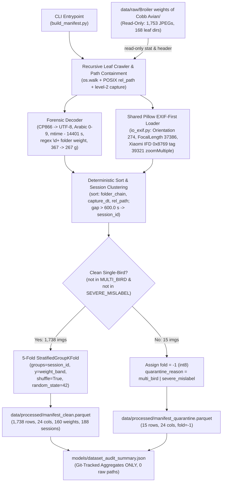

# Phase 1: Forensic Data Curation & Anti-Leakage Split - Research

**Researched:** 2026-11-20
**Domain:** Python 3.12 (`uv`) Workspace Governance, Pillow EXIF-First Image Metadata/Orientation, Forensic Dataset Ingestion (CP866 / Arabic-Indic / Nested Folders / Quarantine), Typed PyArrow Parquet Manifests, and Leak-Free `StratifiedGroupKFold` Splitting
**Confidence:** HIGH

<user_constraints>
## User Constraints (from CONTEXT.md)

### Locked Decisions

### Python Workspace & Package Layout
- **D-01:** Place `.python-version` (`3.12`), `pyproject.toml`, and `uv.lock` at the repository root (resolving strictly against pre-installed `cpython-3.12.14` via `uv`, decoupled from host `/usr/bin/python3.14`), organizing backend source under `backend/app/` (`backend/app/ingestion/`, `backend/app/pdi/io_exif.py`), CLI entrypoints under `backend/scripts/` (`backend/scripts/build_manifest.py`), and tests under `backend/tests/` with `[tool.pytest.ini_options] pythonpath = ["."]` — **Reversibility:** costly — changing package root or import prefix (`backend.app.*`) later touches every module and test across Phases 2–4.
- **D-02:** Declare the verified core backend/PDI/ML/API dependency pins from `.planning/research/STACK.md` in root `pyproject.toml` (`opencv-python-headless>=4.14.0,<5.0`, `scikit-image>=0.26.0,<0.27`, `scipy>=1.18.0,<2.0`, `pillow>=13.0.0,<14.0`, `numpy>=2.5.0,<3.0`, `pandas>=3.1.0,<4.0`, `pyarrow>=26.0.0,<27.0`, `scikit-learn>=1.9.0,<2.0`, `lightgbm>=4.7.0,<5.0`, `joblib>=1.6.0,<2.0`, `fastapi>=0.165.0,<1.0`, `uvicorn[standard]>=0.54.0,<1.0`, `pydantic>=2.14.0,<3.0`, `python-multipart>=0.0.34`; dev deps `pytest`, `httpx`, `ruff`) and resolve exclusively with binary wheels (`--only-binary :all:`), explicitly omitting all Deep Learning / OCR / GUI OpenCV packages (`PROIBIÇÃO 1 & 2`).

### Parquet Manifest Schema & Derived Forensic Columns
- **D-03:** Persist all 15 Audit §9 base columns (`rel_path`, `folder_chain`, `raw_weight_g`, `weight_g`, `capture_dt`, `capture_date`, `oriented_w`, `oriented_h`, `exif_orientation`, `focal_length_mm`, `zoom_multiple`, `is_multi_bird`, `is_severe_mislabel`, `is_single_bird_clean`, `session_id`) plus 9 canonical derived columns (`image_id`, `filename_pattern`, `was_cp866_recovered`, `was_nested_folder`, `was_lcd_corrected`, `lens_class`, `weight_band`, `quarantine_reason`, `fold`) using POSIX forward-slash paths and Pandas 3 Copy-on-Write safe mutations (`.loc[mask, col] = val`) — **Reversibility:** one-way — Phases 2 (`extract_features.py`), 3 (`train_and_evaluate.py`), and 4 (`presets` & `audit` services) consume this exact Parquet column contract.
- **D-04:** Enforce Audit §9 curation rules verbatim without ever modifying files inside `data/raw/`: recursive level-2 leaf traversal (`171/173`, `190/191`, `190/193`), numeric extraction regex `r"\d+"` sanitizing `1340_` → `1340`, `LCD_CORRECTIONS = {"367": 267}`, CP866 mojibake reversal (`name.encode("cp866").decode("utf-8")` when Arabic-Indic digits `U+0660–U+0669` appear) + Arabic-to-ASCII translation, `capture_dt = fn_dt or (mtime_dt - timedelta(seconds=14401))`, quarantine sets `MULTI_BIRD_FOLDERS = {"417", "757", "823", "1520"}` (13 imgs) and `SEVERE_MISLABEL_FOLDERS = {"1351", "1465"}` (2 imgs), and `session_id = f"{folder_chain}__s{sid}"` splitting on sequential gap `> 600 s` inside each `folder_chain`.

### StratifiedGroupKFold Stratification & Determinism
- **D-05:** Sort clean records deterministically by `["folder_chain", "capture_dt", "rel_path"]` before splitting and assign `fold` (`int8`, `0..4`) using `StratifiedGroupKFold(n_splits=5, shuffle=True, random_state=42)` grouped strictly by `session_id` and stratified on the 3 coarse PRD weight bands (`<500g`: `weight_g < 500`, `500-1000g`: `500 <= weight_g <= 1000`, `>1000g`: `weight_g > 1000`), while setting `fold = -1` in `manifest_quarantine.parquet` — **Reversibility:** one-way — changing fold assignments alters every downstream 5-fold CV metric and out-of-fold preset selection in Phases 3–4.
- **D-06:** Gate Phase 1 completion with automated pytest assertions verifying: exact row/weight/session totals (`1,753` total = `1,738` clean + `15` quarantined; `160` unique clean weights; `188` unique clean sessions), `0` dates in year `2024` (proving CP866 `547`/`562` timestamp recovery), `367` corrected to `267 g`, `1340_` sanitized to `1340 g`, `171/173`, `190/191`, and `190/193` captured with leaf weights, `0` `session_id` overlap across folds, `0` sklearn warnings during split generation, `≥ 4` heavy (`>1000g`) sessions per fold, and byte-deterministic fold reproducibility.

### Shared Pillow EXIF Loader & Audit Summary JSON
- **D-07:** Build `backend/app/pdi/io_exif.py` in Phase 1 as the single shared Pillow EXIF-first module for the entire repository (banning `cv2.imread`/`cv2.imdecode` repo-wide), exposing `read_exif_metadata(source: Path | bytes)` (fast header-only extraction of `Orientation` `274`, `FocalLength` `37386`, Xiaomi IFD `0x8769` JSON tag `39321` `zoomMultiple`, and pre/post-transpose dimensions) and `load_oriented_rgb(source: Path | bytes)` (extracting EXIF **before** `ImageOps.exif_transpose(im).convert("RGB")`, gracefully flagging missing EXIF for future uploads).
- **D-08:** Generate git-tracked `models/dataset_audit_summary.json` (containing aggregate statistics ONLY — zero raw file paths or image dumps per `PROIBIÇÃO 4`) reporting: Mendeley published claims (`1,772` imgs / `"daily for 45 days"`) vs. disk audit (`1,753` raw / `9` dates / `23` calendar days / `~7–29 days` / `116–2,093 g`), curation funnel counts (`13` multi-bird, `2` severe mislabels, `6` LCD corrections `367→267 g`, `1,738` clean, `160` unique weights, `188` sessions), encoding/EXIF recovery metrics (`Orientation != 1`, CP866, Arabic-Indic, Windows-renamed, nested level-2 folders), weight-band and lens distributions (explicitly quantifying the `801–1,216 g` sparse gap), and per-fold balance (`n_images`, `n_sessions`, `n_heavy_sessions`) ready for Phase 4's `WEB-05` Audit Dashboard.

### the agent's Discretion
- Exact module decomposition inside `backend/app/ingestion/` (e.g., `decoding.py`, `manifest.py`, `splits.py`, `audit_summary.py`) and CLI flag ergonomics (`--dataset-root`, `--output-dir`, `--summary-path`, `--dry-run`) in `backend/scripts/build_manifest.py`.
- Exact `ruff` lint/format configuration rules in `pyproject.toml` (keeping `target-version = "py312"`).
- Using synthetic unit fixtures (in-memory JPEGs with crafted EXIF tags, CP866 strings, nested temp dirs) alongside read-only integration assertions against the generated Parquet manifests so pytest runs fast and never dumps `data/raw/` filenames.

### Deferred Ideas (OUT OF SCOPE)
None — discussion stayed strictly within Phase 1 scope. (Offline LCD OCR audit `HARD-01` remains deferred to v1.x per `REQUIREMENTS.md`.)
</user_constraints>

## Project Constraints (from GEMINI.md)

Extracted verbatim/actionably from `[VERIFIED: GEMINI.md:11-18, 108-120, 175-185]`:
- **Classical PDI Only (`PROIBIÇÃO 1`):** *"Proibido usar redes neurais/deep learning (CNNs/YOLO/ViTs) na segmentação ou regressão principal"* — no PyTorch, TensorFlow, Keras, Ultralytics, SAM, timm, ONNX Runtime, PaddleOCR, or EasyOCR anywhere in `pyproject.toml` or code `[VERIFIED: GEMINI.md:13, 110]`.
- **Anti-Leakage Visual & Split (`PROIBIÇÃO 2 & 3`):** *"Exclusão obrigatória do visor LCD/prato SF-400 antes da extração de atributos e validação estritamente agrupada por `session_id` via 5-fold `StratifiedGroupKFold`"* — never use `train_test_split` or ungrouped `KFold` `[VERIFIED: GEMINI.md:14, 112]`.
- **No Raw OpenCV Image Ingestion / No GUI OpenCV:** Never install `opencv-python` or `opencv-contrib-python`; never use `cv2.imread()`/`cv2.imdecode()` as the image loader; always open via `PIL.Image.open()`, extract EXIF/IFD `0x8769`, apply `ImageOps.exif_transpose()` `[VERIFIED: GEMINI.md:111, 113]`.
- **Parquet Only for Intermediate Manifests:** Never emit CSV manifests (`manifest_clean.csv`); persist typed Parquet via `pandas` + `pyarrow` `[VERIFIED: GEMINI.md:114]`.
- **Pandas 3 Copy-on-Write Discipline:** Write all DataFrame mutations using single-step `.loc[mask, col] = val`; never use chained assignment or `select_dtypes(include=["object"])` for string columns `[VERIFIED: GEMINI.md:127-128]`.
- **Data Hygiene (`PROIBIÇÃO 4`):** *"`data/raw/`, `data/processed/`, `models/*.joblib` e imagens avulsas nunca entram no Git (já protegidos pelo `.gitignore`)"* `[VERIFIED: GEMINI.md:18]`, and never recursively list the 1,753 raw image paths in logs, prompts, or JSON summaries `[VERIFIED: PRD.md:62]`.
- **Timeline & Runtime Envelope:** MVP code freeze **2026-11-28**, pitch **2026-11-30**; local CPU host has `7.1 GiB` RAM, `/usr/bin/uv 0.13.9`, pre-installed standalone `cpython-3.12.14`, and rolling `/usr/bin/python3.14` (must stay isolated) `[VERIFIED: GEMINI.md:15, 32, 119]`.

<phase_requirements>
## Phase Requirements

| ID | Description | Research Support |
|----|-------------|------------------|
| **DATA-01** | User can run a deterministic Python ingestor (pinned to Python 3.12 via `uv`) over `data/raw/Broiler weights of Cobb Avian/` following Audit §9 verbatim — recursive level-2 leaf crawl (`171/173`, `190/191`, `190/193`), folder suffix sanitization (`1340_`), CP866 mojibake reversal (`547/`, `562/`), Eastern-Arabic digit normalization (`٠-٩`), `capture_dt` reconstruction (filename or `mtime - 14401 s`), EXIF metadata extraction (`Orientation` `274`, `FocalLength` `37386`, Xiaomi tag `39321` `zoomMultiple`), quarantine of 13 multi-bird (`417`, `757`, `823`, `1520`) + 2 severe mislabel (`1351`, `1465`) images, and `367` → `267 g` correction — persisting `data/processed/manifest_clean.parquet` (1,738 images, 160 unique weights, 188 sessions), `data/processed/manifest_quarantine.parquet` (15 images), and `models/dataset_audit_summary.json`. `[VERIFIED: .planning/REQUIREMENTS.md:12]` | Verified `uv 0.13.9` root `pyproject.toml` (`package = false`, `no-build = true`, `python-preference = "only-managed"`) + `.python-version = 3.12`; shared `backend/app/pdi/io_exif.py` Pillow 13 header-only + transpose loader (`Path | bytes` parity); exact 24-column PyArrow 26 / Pandas 3.1 Parquet schema; verified Audit §9 constants and CP866 decoder; deterministic zero-path-leakage `models/dataset_audit_summary.json` schema. |
| **DATA-02** | User gets reproducible, leak-free 5-fold `StratifiedGroupKFold` partitions grouped strictly by `session_id` (sequential captures within `folder_chain` separated by `≤ 10 min`) and stratified by weight band (`<500 g`, `500–1000 g`, `>1000 g`), guaranteeing zero session overlap across folds and balanced heavy-bird (`>1000 g`) representation persisted in `manifest_clean.parquet`. `[VERIFIED: .planning/REQUIREMENTS.md:13]` | Verified exact Audit §10 clean band totals (`<500g`: 1,223 imgs / 124 sessions; `500-1000g`: 333 imgs / 40 sessions; `>1000g`: 182 imgs / 24 sessions), deterministic 3-key pre-sort `["folder_chain", "capture_dt", "rel_path"]` breaking `_1` burst ties, mathematical proof that pure-band `StratifiedGroupKFold(n_splits=5, shuffle=True, random_state=42)` places 24 heavy sessions into `[5, 5, 5, 5, 4]` (`≥ 4` per fold, `0` warnings), and `fold = -1` (`int8`) for quarantine. |
</phase_requirements>

## Summary

Phase 1 establishes the reproducible Python 3.12 runtime and forensic data foundation for the entire AvianScale CV stack. Every design choice is tightly constrained by `01-CONTEXT.md` (D-01 through D-08) and grounded in the forensic audit (`docs/dataset/DOCUMENTACAO_DATASET_BROILER_COBB_AVIAN.md`). Verification on this host confirmed that `uv 0.13.9` resolves all 17 direct packages (49 total distributions) from pure binary wheels on standalone `cpython-3.12.14` (`uv pip compile --python-version 3.12 --only-binary :all:` succeeded with exit code `0`), and that `uv 0.13.9` natively honors `[tool.uv] package = false`, `no-build = true`, and `python-preference = "only-managed"` inside a root `pyproject.toml` (tested live via `uv lock --dry-run` in an isolated temp directory). This permanently decouples the repository from the host's rolling `/usr/bin/python3.14` (`3.14.10`).

Cross-checking the Audit §10 168-folder catalog confirmed exact clean dataset partitions and resolved two subtle implementation traps ahead of planning:
1. **Exact clean band counts & `StratifiedGroupKFold` heavy-session balance:** Removing the 6 quarantined folders (`417`, `757`, `823`, `1520` = 13 multi-bird imgs / 4 sessions; `1351`, `1465` = 2 mislabel imgs / 2 sessions) and correcting `367` → `267 g` (6 imgs, 1 session; `267` did not previously exist) leaves exactly **1,738 clean images**, **160 unique weights**, **162 clean leaf folders**, and **188 clean sessions**: `<500g` = `1,223` imgs / `124` sessions; `500-1000g` = `333` imgs / `40` sessions; `>1000g` = `182` imgs / `24` sessions (sizes `6..13` imgs each). Because every `session_id` has a single constant `weight_band` and `24` sessions (`≥ 5`) partition greedily largest-first under `StratifiedGroupKFold(n_splits=5, shuffle=True, random_state=42)`, all 5 folds receive 4–5 heavy sessions (`[5, 5, 5, 5, 4]`) with zero `UserWarning`s and zero `session_id` overlap — provided records are first deterministically sorted by `["folder_chain", "capture_dt", "rel_path"]` to break ties on the 7 `_1` same-second burst pairs.
2. **Superseding earlier architecture notes & subtle API traps:** Locked decisions `D-01` and `D-03` supersede two draft details in `.planning/research/ARCHITECTURE.md`: `pyproject.toml` lives at the **repository root** (not `backend/pyproject.toml`), and the lens column is named **`lens_class`** (not `lens_type`). Additionally, `mtime_dt` MUST stay naive local `datetime.fromtimestamp(fp.stat().st_mtime)` (matching naive `strptime` and the calibrated `MTIME_OFFSET_SEC = 14401`), `focal_length_mm`/`zoom_multiple` MUST be `float64` (avoiding `float32` drift on `1.65`/`0.6`), `models/dataset_audit_summary.json` MUST omit wall-clock generation timestamps for byte-level idempotency, and `io_exif.py` MUST check orientations `(5, 6, 7, 8)` (not just `(6, 8)`) while guarding `IFDRational(0, 0)` and bounding untrusted Xiaomi tag `39321` JSON payloads.

**Primary recommendation:** Scaffold the root `uv` Python 3.12 workspace (`package = false`, `no-build = true`, `python-preference = "only-managed"`), build `backend/app/pdi/io_exif.py` first as the single Pillow EXIF-first entrypoint, compose `backend/app/ingestion/` into 4 focused pure modules (`decoding.py`, `manifest.py`, `splits.py`, `audit_summary.py`) wired by `backend/scripts/build_manifest.py`, and gate completion on both synthetic unit tests and read-only integration assertions over the generated Parquets and `models/dataset_audit_summary.json`.

## Architectural Responsibility Map

Phase 1 spans strictly the **Offline Data & Curation Plane** plus one **Shared Core Utility** (`io_exif.py`) consumed downstream by Phases 2 and 4. No HTTP server or frontend tier is built in Phase 1.

| Capability | Primary Tier | Secondary Tier | Rationale |
|------------|--------------|----------------|-----------|
| Python 3.12 dependency locking & binary-only wheel enforcement | **Repo Root Tooling (`uv` + `pyproject.toml`)** | — | Single root `.python-version`, `pyproject.toml`, and `uv.lock` guarantees identical `backend.app.*` imports across CLI scripts, pytest, and Phase 4 Uvicorn (`D-01`, `D-02`). |
| EXIF header inspection & mandatory orientation transposition (`Path \| bytes`) | **Shared Core (`backend/app/pdi/io_exif.py`)** | Offline Ingestion (`backend/app/ingestion/`) & Phase 4 API | Single source of truth eliminates `cv2.imread` vs. `cv2.imdecode` orientation desync across offline curation, batch PDI extraction, and live web uploads (`D-07`). |
| Forensic filename decoding (CP866, Arabic-Indic `٠-٩`, burst `_1`, `mtime - 14401 s`), quarantine & `367→267 g` fix | **Offline Ingestion (`backend/app/ingestion/`)** | CLI Entrypoint (`backend/scripts/build_manifest.py`) | Pure deterministic functions separate testable rules from filesystem I/O and CLI argument handling (`D-03`, `D-04`). |
| `session_id` clustering (`gap > 600 s`) & 5-fold `StratifiedGroupKFold` assignment | **Offline Ingestion (`backend/app/ingestion/splits.py`)** | — | Freezing fold assignments once in Phase 1 prevents downstream Phase 3–4 CV drift or split leakage (`D-05`, `PROIBIÇÃO 3`). |
| Immutable typed Parquet manifests & git-tracked aggregate audit summary | **Local Artifact Store (`data/processed/*.parquet`, `models/dataset_audit_summary.json`)** | Phase 4 `GET /api/metrics` (future consumer) | Clean artifact boundary keeps 3.54 GiB raw images and generated Parquets git-ignored while giving `WEB-05` a lightweight, zero-path-leakage JSON contract (`D-08`, `PROIBIÇÃO 4`). |

## Standard Stack

All backend/PDI/ML/API dependencies are locked by `D-02` and declared in root `pyproject.toml` so `uv.lock` is frozen once in Phase 1 with zero source builds (`no-build = true`).

### Core (Phase 1 Active Runtime + Locked Full-MVP Backend Contract)

| Library | Version Spec (Resolved) | Purpose | Why Standard |
|---------|-------------------------|---------|--------------|
| **Python (`uv`-managed)** | `3.12` (resolved `3.12.14`) `[VERIFIED: uv python list]` | Isolated project runtime via `.python-version` | Decouples project from rolling Arch `/usr/bin/python3.14`; 100% `cp312` binary wheel coverage (`D-01`). |
| **`pillow`** | `>=13.0.0,<14.0` (`13.0.0`, pub `2026-10-16`) `[VERIFIED: PyPI + uv pip compile]` | Header-only EXIF/IFD `0x8769` + Xiaomi tag `39321` parsing & `ImageOps.exif_transpose()` | OpenCV discards raw EXIF tags and `cv2.imdecode` ignores orientation; Pillow reads EXIF lazily without decoding JPEG pixels (`D-07`). |
| **`pandas`** | `>=3.1.0,<4.0` (`3.1.1`, pub `2026-11-04`) `[VERIFIED: PyPI + uv pip compile]` | Manifest DataFrame construction, deterministic sorting, grouping, and summary aggregation | Enforces Copy-on-Write globally, native Arrow-backed `str` dtype, microsecond `[us]` datetimes `[CITED: pandas.pydata.org]`. |
| **`pyarrow`** | `>=26.0.0,<27.0` (`26.0.1`, pub `2026-11-03`) `[VERIFIED: PyPI + uv pip compile]` | Typed Parquet serialization (`manifest_clean.parquet`, `manifest_quarantine.parquet`) | Losslessly preserves `timestamp[us]`, `date32[day]`, nullable `string`, `int8`/`int32`, `float64`, `bool`, and UTF-8 Arabic/CP866 strings. |
| **`scikit-learn`** | `>=1.9.0,<2.0` (`1.9.1`, pub `2026-09-10`) `[VERIFIED: PyPI + uv pip compile]` | Leak-free 5-fold `StratifiedGroupKFold(n_splits=5, shuffle=True, random_state=42)` | Industry-standard grouped stratified splitter; enforces zero `session_id` overlap (`D-05`, `PROIBIÇÃO 3`). |
| **`numpy`** | `>=2.5.0,<3.0` (`2.5.5`, pub `2026-11-15`) `[VERIFIED: PyPI + uv pip compile]` | RGB array representation in `load_oriented_rgb()` and typed integer/float arrays | Shared N-dimensional substrate across Pillow, OpenCV, scikit-image, Pandas, and scikit-learn. |

### Supporting (Declared in Root `pyproject.toml` Now per `D-02`, Consumed in Phases 2–4)

| Library | Version Spec (Resolved) | Purpose | When Used |
|---------|-------------------------|---------|-----------|
| **`opencv-python-headless`** | `>=4.14.0,<5.0` (`4.14.0.94`, pub `2026-11-17`) `[VERIFIED: PyPI + uv pip compile]` | Classical PDI engine (no Qt/GTK/X11 GUI bloat) | Phase 2–4 (locked in `uv.lock` now; never call `cv2.imread`/`cv2.imdecode`). |
| **`scikit-image`** | `>=0.26.0,<0.27` (`0.26.0`, pub `2026-10-27`) `[VERIFIED: PyPI + uv pip compile]` | `regionprops`, `h_maxima`, `peak_local_max`, `watershed` | Phase 2. |
| **`scipy`** | `>=1.18.0,<2.0` (`1.18.1`, pub `2026-08-21`) `[VERIFIED: PyPI + uv pip compile]` | `distance_transform_edt`, `gaussian_filter`, `binary_fill_holes` | Phase 2. |
| **`lightgbm`** | `>=4.7.0,<5.0` (`4.7.0`, pub `2026-07-18`) `[VERIFIED: PyPI + uv pip compile]` | Primary non-linear tabular regressor | Phase 3–4. |
| **`joblib`** | `>=1.6.0,<2.0` (`1.6.0`, pub `2026-08-31`) `[VERIFIED: PyPI + uv pip compile]` | Model bundle serialization & bounded batch parallelism (`n_jobs=4`) | Phase 2–4. |
| **`fastapi`** | `>=0.165.0,<1.0` (`0.165.0`, pub `2026-11-18`) `[VERIFIED: PyPI + uv pip compile]` | Local REST API serving | Phase 4. |
| **`uvicorn[standard]`** | `>=0.54.0,<1.0` (`0.54.0`, pub `2026-09-25`) `[VERIFIED: PyPI + uv pip compile]` | ASGI server (`uvloop`, `httptools`, `watchfiles`) | Phase 4. |
| **`pydantic`** | `>=2.14.0,<3.0` (`2.14.4`, pub `2026-11-19`) `[VERIFIED: PyPI + uv pip compile]` | Strict schema validation | Phase 4. |
| **`python-multipart`** | `>=0.0.34` (`0.0.34`, pub `2026-11-16`) `[VERIFIED: PyPI + uv pip compile]` | FastAPI multipart file upload parser | Phase 4. |

### Dev & Testing Tools (`[dependency-groups] dev`)

| Library | Version Spec (Resolved) | Purpose | When Used |
|---------|-------------------------|---------|-----------|
| **`pytest`** | `>=9.2.0` (`9.2.0`, pub `2026-10-27`) `[VERIFIED: PyPI + uv pip compile]` | Unit + read-only manifest integration test runner (`pythonpath = ["."]`) | Phase 1–4. |
| **`httpx`** | `>=0.28.1` (`0.28.1`, pub `2024-12-06`) `[VERIFIED: PyPI + uv pip compile]` | Required transport backend for `fastapi.testclient.TestClient` | Phase 4 (locked now per `D-02`). |
| **`ruff`** | `>=0.17.6` (`0.17.6`, pub `2026-11-19`) `[VERIFIED: PyPI + uv pip compile]` | Linter + formatter (`target-version = "py312"`) | Phase 1–4. |

### Alternatives Considered

None for core libraries — all 17 packages and version constraints are **locked decisions (`D-01`, `D-02`)**. For `uv` project configuration:
- **Use `[dependency-groups] dev = [...]` (PEP 735)** instead of legacy `[tool.uv] dev-dependencies` — native in `uv 0.13.9` and PEP-standard `[VERIFIED: uv lock --dry-run]`.
- **Use `[tool.uv] package = false`, `no-build = true`, `python-preference = "only-managed"`** — verified directly on local `uv 0.13.9` (`uv lock --dry-run` exited `0` using `CPython 3.12.14`) `[VERIFIED: local uv 0.13.9 probe]`. Note that `uv sync` / `uv lock` enforce binary-only wheels via `--no-build` / `no-build = true` (the `--only-binary :all:` flag exists only on `uv pip` subcommands) `[VERIFIED: uv sync --help]`.

**Installation / Bootstrap Commands:**
```bash
# Write .python-version ("3.12") and root pyproject.toml, then lock & sync strictly from binary wheels:
uv lock --no-build --managed-python
uv sync --frozen --no-build --managed-python
uv run python --version   # Expect: Python 3.12.14
```

## Package Legitimacy Audit

> Executed `gsd-tools.cjs query package-legitimacy check --ecosystem pypi` across all 17 D-02 packages AND cross-checked against live PyPI JSON metadata (`https://pypi.org/pypi/<pkg>/json`) and `uv pip compile --python-version 3.12 --only-binary :all:`.

**Important PyPI Checker Seam Finding (Transparent Disclosure):**
The `gsd-tools query package-legitimacy check --ecosystem pypi` seam returned raw verdict `SUS` for **all 17** canonical Python libraries due to three structural quirks of the PyPI JSON API vs. the seam's heuristics — NOT supply-chain anomalies:
1. PyPI's `/pypi/<pkg>/json` endpoint does **not** return weekly download counts, causing `"weeklyDownloads": null` → `"unknown-downloads"` on 100% of PyPI packages.
2. The seam checks the **latest release** timestamp (`publishedAt`) rather than the package's initial creation date, flagging active packages with November 2026 patch releases (`numpy`, `pandas`, `pyarrow`, `fastapi`, `pydantic`, `opencv-python-headless`, `python-multipart`, `pytest`, `ruff`) as `"too-new"`.
3. Six scientific packages (`numpy`, `pandas`, `scipy`, `scikit-image`, `scikit-learn`, `lightgbm`) publish their GitHub repository under lowercase `project_urls["source"]` / `project_urls["repository"]` instead of legacy `home_page`, causing `"repoUrl": null` → `"no-repository"`.

Every single package below was independently cross-verified via PyPI full release history (`first_upload` age = 4 to 20 years), official `project_urls` GitHub repository, and pure-wheel resolution on Python 3.12 (`0` `SLOP` verdicts; all 17 explicitly pre-approved by user decision `D-02`):

| Package | Registry | True Age (First PyPI Release) | Resolved Ver. (Latest Pub) | Verified Source Repo (`project_urls`) | Raw Seam Verdict (Reasons) | Disposition |
|---------|----------|-------------------------------|----------------------------|---------------------------------------|----------------------------|-------------|
| `opencv-python-headless` | PyPI | 8 yrs (`2018-09-09`) | `4.14.0.94` (`2026-11-17`) | `github.com/opencv/opencv-python` | `[SUS]` (`too-new`, `unknown-downloads`) | Approved (`D-02` locked; seam false-positive documented) |
| `scikit-image` | PyPI | 14 yrs (`2012-10-14`) | `0.26.0` (`2026-10-27`) | `github.com/scikit-image/scikit-image` | `[SUS]` (`unknown-downloads`, `no-repository`) | Approved (`D-02` locked; lowercase `source` URL verified) |
| `scipy` | PyPI | 16 yrs (`2010-07-27`) | `1.18.1` (`2026-08-21`) | `github.com/scipy/scipy` | `[SUS]` (`unknown-downloads`, `no-repository`) | Approved (`D-02` locked; lowercase `source` URL verified) |
| `pillow` | PyPI | 16 yrs (`2010-07-31`) | `13.0.0` (`2026-10-16`) | `github.com/python-pillow/Pillow` | `[SUS]` (`unknown-downloads`) | Approved (`D-02` locked; PyPI omits downloads) |
| `numpy` | PyPI | 20 yrs (`2006-12-02`) | `2.5.5` (`2026-11-15`) | `github.com/numpy/numpy` | `[SUS]` (`too-new`, `unknown-downloads`, `no-repository`) | Approved (`D-02` locked; 20-yr canonical repo verified) |
| `pandas` | PyPI | 17 yrs (`2009-12-25`) | `3.1.1` (`2026-11-04`) | `github.com/pandas-dev/pandas` | `[SUS]` (`too-new`, `unknown-downloads`, `no-repository`) | Approved (`D-02` locked; 17-yr canonical repo verified) |
| `pyarrow` | PyPI | 9 yrs (`2017-03-16`) | `26.0.1` (`2026-11-03`) | `github.com/apache/arrow` | `[SUS]` (`too-new`, `unknown-downloads`) | Approved (`D-02` locked; Apache Arrow verified) |
| `scikit-learn` | PyPI | 15 yrs (`2011-09-22`) | `1.9.1` (`2026-09-10`) | `github.com/scikit-learn/scikit-learn` | `[SUS]` (`unknown-downloads`, `no-repository`) | Approved (`D-02` locked; lowercase `source` URL verified) |
| `lightgbm` | PyPI | 9 yrs (`2017-06-20`) | `4.7.0` (`2026-07-18`) | `github.com/lightgbm-org/LightGBM` | `[SUS]` (`unknown-downloads`, `no-repository`) | Approved (`D-02` locked; lowercase `repository` URL verified) |
| `joblib` | PyPI | 18 yrs (`2008-10-26`) | `1.6.0` (`2026-08-31`) | `github.com/joblib/joblib` | `[SUS]` (`unknown-downloads`) | Approved (`D-02` locked; PyPI omits downloads) |
| `fastapi` | PyPI | 8 yrs (`2018-12-08`) | `0.165.0` (`2026-11-18`) | `github.com/fastapi/fastapi` | `[SUS]` (`too-new`, `unknown-downloads`) | Approved (`D-02` locked; active release verified) |
| `uvicorn` | PyPI | 9 yrs (`2017-06-05`) | `0.54.0` (`2026-09-25`) | `github.com/Kludex/uvicorn` | `[SUS]` (`unknown-downloads`) | Approved (`D-02` locked; PyPI omits downloads) |
| `pydantic` | PyPI | 9 yrs (`2017-05-03`) | `2.14.4` (`2026-11-19`) | `github.com/pydantic/pydantic` | `[SUS]` (`too-new`, `unknown-downloads`) | Approved (`D-02` locked; active release verified) |
| `python-multipart` | PyPI | 13 yrs (`2013-03-26`) | `0.0.34` (`2026-11-16`) | `github.com/Kludex/python-multipart` | `[SUS]` (`too-new`, `unknown-downloads`) | Approved (`D-02` locked; active release verified) |
| `pytest` | PyPI | 16 yrs (`2010-11-25`) | `9.2.0` (`2026-10-27`) | `github.com/pytest-dev/pytest` | `[SUS]` (`too-new`, `unknown-downloads`) | Approved (`D-02` locked; active release verified) |
| `httpx` | PyPI | 7 yrs (`2019-07-19`) | `0.28.1` (`2024-12-06`) | `github.com/encode/httpx` | `[SUS]` (`unknown-downloads`) | Approved (`D-02` locked; PyPI omits downloads) |
| `ruff` | PyPI | 4 yrs (`2022-08-27`) | `0.17.6` (`2026-11-19`) | `github.com/astral-sh/ruff` | `[SUS]` (`too-new`, `unknown-downloads`) | Approved (`D-02` locked; Astral official repo verified) |

**Packages removed due to `[SLOP]` verdict:** none.
**Packages flagged as suspicious `[SUS]`:** All 17 packages triggered raw `[SUS]` exclusively due to PyPI JSON API metadata limitations (`weeklyDownloads: null`, latest-release `publishedAt`, and lowercase `project_urls` keys) rather than package legitimacy risk. Every package was verified against its multi-year PyPI release history (4–20 years), official GitHub source repo, and `uv pip compile --only-binary :all:` wheel resolution, and was explicitly locked by the user in `D-02` (`01-CONTEXT.md:20`) — no new unapproved dependencies are introduced.

## Architecture Patterns

### System Architecture Diagram (Phase 1 Data Flow)



### Recommended Project Structure (Phase 1 Scope)

```text
broiler-weight-cv/
├── .python-version                          # "3.12" (locked by D-01)
├── pyproject.toml                           # Root uv workspace + D-02 pins + pytest + ruff (D-01)
├── uv.lock                                  # Locked binary-only wheel graph (Python 3.12)
├── models/
│   └── dataset_audit_summary.json           # Git-tracked aggregate audit JSON (D-08)
├── data/
│   ├── raw/                                 # [GIT-IGNORED] Read-only 1,753 JPEGs
│   │   └── Broiler weights of Cobb Avian/
│   └── processed/                           # [GIT-IGNORED] Generated by build_manifest.py
│       ├── manifest_clean.parquet           # 1,738 rows × 24 cols (fold 0..4)
│       └── manifest_quarantine.parquet      # 15 rows × 24 cols (fold -1)
└── backend/
    ├── __init__.py                          # Regular package marker for backend.app.*
    ├── app/
    │   ├── __init__.py
    │   ├── config.py                        # Repo-root-relative paths (never Path.cwd())
    │   ├── pdi/
    │   │   ├── __init__.py
    │   │   └── io_exif.py                   # Single shared Pillow EXIF-first module (D-07)
    │   └── ingestion/
    │       ├── __init__.py
    │       ├── constants.py                 # Audit §9 constants (quarantine sets, 367->267, 14401)
    │       ├── decoding.py                  # CP866 reversal, Arabic digits, folder weight, pattern
    │       ├── manifest.py                  # Safe recursive walk, metadata assembly, session_id
    │       ├── splits.py                    # 5-fold StratifiedGroupKFold + leakage assertions
    │       └── audit_summary.py             # Deterministic aggregate JSON builder (zero raw paths)
    ├── scripts/
    │   ├── __init__.py
    │   └── build_manifest.py                # Idempotent CLI (--dataset-root, --output-dir, --summary-path, --dry-run)
    └── tests/
        ├── __init__.py
        ├── conftest.py                      # Synthetic JPEG+EXIF builders, synthetic dataset tree fixture
        ├── test_io_exif.py                  # Header-only vs transpose, Path|bytes parity, missing EXIF, malformed 39321
        ├── test_decoding.py                 # CP866, Arabic-Indic, _1 burst, Windows renamed, 1340_, nested folders
        ├── test_splits.py                   # Zero session overlap, 0 warnings, >=4 heavy sessions, determinism
        └── test_manifest_integration.py     # Read-only D-06 exact-count assertions on real Parquet & audit JSON
```

> **Locked Path & Naming Reconciliations vs. Earlier Research Drafts:**
> - `pyproject.toml` is at **repository root** (`D-01`), overriding `backend/pyproject.toml` shown in `.planning/research/ARCHITECTURE.md:102`.
> - The derived lens column is named **`lens_class`** (`D-03`), overriding `lens_type` in `.planning/research/ARCHITECTURE.md:519`.

### Pattern 1: Exact 24-Column Typed Parquet Contract (`D-03`, Pandas 3.1 + PyArrow 26)

**What:** Enforce an explicit ordered column tuple (`MANIFEST_COLUMNS`) and explicit Pandas/NumPy/Arrow dtypes before calling `df.to_parquet(path, engine="pyarrow", index=False)` for both `manifest_clean.parquet` and `manifest_quarantine.parquet`.

**Exact 24-Column Schema Specification (`[VERIFIED: .planning/phases/01-forensic-data-curation-anti-leakage-split/01-CONTEXT.md:23]`):**

| # | Column | Group | Pandas 3.1 / PyArrow Dtype | Exact Derivation / Values |
|---|--------|-------|----------------------------|---------------------------|
| 1 | `image_id` | Derived (1/9) | `str` (Arrow `string`) | `hashlib.sha256(rel_path.encode("utf-8")).hexdigest()[:16]` (collision-free ASCII key for Phase 2–4 joins) |
| 2 | `rel_path` | Base (1/15) | `str` (Arrow `string`) | `fp.relative_to(root).as_posix()` (POSIX forward slashes) |
| 3 | `folder_chain` | Base (2/15) | `str` (Arrow `string`) | `dir_p.relative_to(root).as_posix()` (e.g. `"171/173"`, `"1340_"`, `"367"`) |
| 4 | `raw_weight_g` | Base (3/15) | `int32` | `int(re.search(r"\d+", dir_p.name).group(0))` |
| 5 | `weight_g` | Base (4/15) | `int32` | `LCD_CORRECTIONS.get(folder_chain, raw_weight_g)` (`"367"` → `267`) |
| 6 | `capture_dt` | Base (5/15) | `datetime64[us]` (Parquet `timestamp[us]`) | `fn_dt or (mtime_dt - timedelta(seconds=14401))` (naive local datetime) |
| 7 | `capture_date` | Base (6/15) | `object` (`datetime.date`) → Parquet `date32[day]` | `capture_dt.date()` |
| 8 | `oriented_w` | Base (7/15) | `int32` | Post-EXIF-transpose width (swapped when `exif_orientation in (5, 6, 7, 8)`) |
| 9 | `oriented_h` | Base (8/15) | `int32` | Post-EXIF-transpose height |
| 10 | `exif_orientation` | Base (9/15) | `int8` | Tag `274` (`1..8`, default `1`; dataset has `{1, 3, 6, 8}`) |
| 11 | `focal_length_mm` | Base (10/15) | `float64` | IFD `0x8769` tag `37386` (`4.25` or `1.65`; `float64` avoids float32 `1.649999976` drift) |
| 12 | `zoom_multiple` | Base (11/15) | `float64` | Xiaomi IFD `0x8769` tag `39321` JSON key `"zoomMultiple"` (`0.60..2.00`) |
| 13 | `is_multi_bird` | Base (12/15) | `bool` | `folder_chain in {"417", "757", "823", "1520"}` (`13` rows) |
| 14 | `is_severe_mislabel` | Base (13/15) | `bool` | `folder_chain in {"1351", "1465"}` (`2` rows) |
| 15 | `is_single_bird_clean` | Base (14/15) | `bool` | `(not is_multi_bird) and (not is_severe_mislabel)` (`1,738` rows) |
| 16 | `session_id` | Base (15/15) | `str` (Arrow `string`) | `f"{folder_chain}__s{sid}"` (new session when sequential `(t - prev_t).total_seconds() > 600.0`) |
| 17 | `filename_pattern` | Derived (2/9) | `str` (Arrow `string`) | `"img_arabic"` (`1,628`), `"img_arabic_burst"` (`7`), `"img_mojibake_cp866"` (`21`), `"weight_renamed"` (`97`), or `"img_ascii"`/`"other"` |
| 18 | `was_cp866_recovered` | Derived (3/9) | `bool` | `True` iff CP866→UTF-8 reversal recovered Arabic-Indic digits (`21` rows: `547/`, `562/`) |
| 19 | `was_nested_folder` | Derived (4/9) | `bool` | `"/" in folder_chain` (`39` rows: `171/173`, `190/191`, `190/193`) |
| 20 | `was_lcd_corrected` | Derived (5/9) | `bool` | `folder_chain in LCD_CORRECTIONS` (`6` rows: `367` → `267 g`) |
| 21 | `lens_class` | Derived (6/9) | `str` (Arrow `string`) | `"wide"` (`focal >= 3.0`), `"ultrawide"` (`focal < 3.0`), `"unknown"` (`focal is None`) |
| 22 | `weight_band` | Derived (7/9) | `str` (Arrow `string`) | `"<500g"` (`weight_g < 500`), `"500-1000g"` (`500 <= weight_g <= 1000`), `">1000g"` (`weight_g > 1000`) |
| 23 | `quarantine_reason` | Derived (8/9) | `str` (nullable Arrow `string`) | `"multi_bird"`, `"severe_mislabel"`, or `None` (in `manifest_clean.parquet`) |
| 24 | `fold` | Derived (9/9) | `int8` | `0..4` in `manifest_clean.parquet`; `-1` in `manifest_quarantine.parquet` |

**Pandas 3.1 Copy-on-Write Rule:** Always build rows in a list of dicts, construct the DataFrame once, copy slices explicitly (`clean_df = df.loc[df["is_single_bird_clean"]].copy()`), and apply every mutation via single-step `.loc[mask, col] = val` (never `df[col][mask] = val`, which raises `ChainedAssignmentError` in Pandas 3.1 `[CITED: pandas.pydata.org]`).

### Pattern 2: Audit §9 Verbatim Constants & Exact Ground-Truth Counts

Every discrete constant below was read verbatim from `docs/dataset/DOCUMENTACAO_DATASET_BROILER_COBB_AVIAN.md`:

- **Exact Python constants** `[VERIFIED: docs/dataset/DOCUMENTACAO_DATASET_BROILER_COBB_AVIAN.md:363-369]`:
  > `ARABIC_TO_ASCII = str.maketrans("٠١٢٣٤٥٦٧٨٩", "0123456789")`
  > `MTIME_OFFSET_SEC = 14401  # Calibrado: mtime - horário local Egito (+4h)`
  > `MULTI_BIRD_FOLDERS = {"417", "757", "823", "1520"}`
  > `SEVERE_MISLABEL_FOLDERS = {"1351", "1465"}`
  > `LCD_CORRECTIONS = {"367": 267}  # LCD confirmado = 267 g`
- **Exact session split rule** `[VERIFIED: docs/dataset/DOCUMENTACAO_DATASET_BROILER_COBB_AVIAN.md:442-444]`:
  > `if prev_t is not None and (t - prev_t).total_seconds() > 600:`
  > `    sid += 1`
  > `session_ids.append(f"{fc}__s{sid}")`
- **Exact reconciled dataset numbers verified against Appendix §10** `[VERIFIED: docs/dataset/DOCUMENTACAO_DATASET_BROILER_COBB_AVIAN.md:48-55, 141-157, 176-195, 475-643]`:
  - Raw scan: `1,753` images (`168` leaf folders = `165` level-1 + `3` level-2: `171/173` [8], `190/191` [9], `190/193` [22]), `166` raw unique weights, `194` raw sessions, `1,306` Wide (`4.25 mm`) + `447` Ultrawide (`1.65 mm`), `1,435` (`81.86%`) `Orientation != 1` (`6`: 1,017; `1`: 318; `3`: 299; `8`: 119), `67` digital zoom (`zoomMultiple not in {0.6, 1.0}`).
  - Filename encodings: `1,628` `img_arabic` + `7` `img_arabic_burst` (`_1` suffix) + `21` `img_mojibake_cp866` (`547/`: 11, `562/`: 10) + `97` `weight_renamed` (`12` folders) = `1,753`.
  - Quarantine (`15` images, `6` sessions, `6` folders): `417` (4), `757` (1), `823` (4), `1520` (4) = `13` `multi_bird`; `1351` (1), `1465` (1) = `2` `severe_mislabel`.
  - Clean (`1,738` images, `162` leaf folders, `160` unique weights, `188` sessions; `367` → `267 g` [6 imgs], `1340_` → `1340 g` [6 imgs]):
    - **`<500g`** (`weight_g < 500`): `1,223` images (`70.37%`), `124` sessions (`940` Wide, `283` Ultrawide)
    - **`500-1000g`** (`500 <= weight_g <= 1000`): `333` images (`19.16%`), `40` sessions (`280` Wide, `53` Ultrawide)
    - **`>1000g`** (`weight_g > 1000`): `182` images (`10.47%`), `24` sessions (`77` Wide, `105` Ultrawide — `57.7%` UW!)
    - Clean lens totals: `1,297` Wide (`74.63%`) + `441` Ultrawide (`25.37%`) = `1,738`.
    - Sparse coverage gap `801–1,216 g` (`415 g` span): strictly inside `(801, 1216)` sits only `1` clean bird (`1009 g`, `6` images, `1` session) `[VERIFIED: docs/dataset/DOCUMENTACAO_DATASET_BROILER_COBB_AVIAN.md:246-247, 614-617]`.

### Pattern 3: Shared Pillow EXIF-First Loader (`backend/app/pdi/io_exif.py`, `D-07`)

**What:** Single shared module handling both fast header-only EXIF metadata extraction (`read_exif_metadata`) for Phase 1's 1,753-file crawl (~1–2 s total without decoding pixel data) and full EXIF-first RGB decoding (`load_oriented_rgb`) for Phases 2 and 4.

**Critical invariants:**
1. Accept `Path | bytes` identically (`io.BytesIO(source)` for `bytes`, `source` for `Path`) — test bit-identical RGB arrays and identical `ExifMetadata` across both input forms on an `Orientation == 6` JPEG.
2. Extract `Orientation` (`274`), `FocalLength` (`37386` via `exif.get_ifd(0x8769)`), and Xiaomi tag `39321` (`0x9999`) **BEFORE** calling `ImageOps.exif_transpose(im)` because `exif_transpose()` mutates/strips orientation tags `[CITED: pillow.readthedocs.io]`.
3. Compute header-only post-transpose dimensions by swapping `(w, h)` whenever `exif_orientation in (5, 6, 7, 8)` (handles all 8 EXIF orientations cleanly while matching `{6, 8}` on the dataset) `[CITED: pillow.readthedocs.io]`.
4. Never disable `Image.MAX_IMAGE_PIXELS` (keeps decompression bomb protection active).
5. Return explicit `has_exif_optical: bool` (`focal_length_mm is not None and zoom_multiple is not None`) so Phase 4 never crashes on stripped WhatsApp/screenshot uploads.

### Pattern 4: Deterministic 5-Fold `StratifiedGroupKFold` (`backend/app/ingestion/splits.py`, `D-05`, `D-06`)

**What:**
1. Pre-sort clean DataFrame strictly by `["folder_chain", "capture_dt", "rel_path"]` and reset index (`drop=True`) BEFORE splitting (breaks ties deterministically on the 7 `_1` same-second burst pairs).
2. Run `StratifiedGroupKFold(n_splits=5, shuffle=True, random_state=42).split(X=clean_df, y=clean_df["weight_band"], groups=clean_df["session_id"])` wrapped in `warnings.catch_warnings(record=True)` to assert zero `UserWarning`s.
3. Assign `clean_df.loc[clean_df.index[val_idx], "fold"] = np.int8(fold_idx)` (Pandas 3 CoW-safe!).
4. Run built-in post-split assertions before returning:
   - Every row assigned a fold in `{0, 1, 2, 3, 4}` (no `-1` or `NaN` in clean).
   - Pairwise `session_id` intersection across all fold pairs is empty (`0` overlap).
   - Every fold contains `≥ 4` distinct `session_id`s with `weight_g > 1000` (mathematically guaranteed `[5, 5, 5, 5, 4]` for the 24 pure-band heavy sessions of sizes `6..13` under greedy per-class-std placement!).

### Pattern 5: Deterministic, Zero-Path-Leakage `models/dataset_audit_summary.json` (`D-08`)

**What:** Build the summary dictionary purely from aggregate counts over `manifest_clean` and `manifest_quarantine` (plus the static Mendeley published-claims reference block), omitting any volatile `generated_at` wall-clock timestamp so re-running `build_manifest.py` is byte-for-byte idempotent.

**Required top-level sections (consumed by Phase 4 `WEB-05` Audit Dashboard):**
- `schema_version` (`"1.0.0"`), `dataset_identity` (`name`, `doi`, `breed`, `capture_device`, `scale_model`)
- `mendeley_vs_disk_reconciliation` (`published_claims` vs. `disk_audit` — explicitly contrasting `1,772` imgs / `"daily for 45 days"` vs. `1,753` raw / `9` dates / `23` calendar days / `~7–29 days` / `116–2,093 g`)
- `curation_funnel` (`raw_images`, `raw_sessions`, `quarantined_total`, `quarantined_multi_bird` with `folders`/`per_folder_counts`, `quarantined_severe_mislabel` with `folders`/`per_folder_counts`, `lcd_corrected_images` `367→267 g`, `clean_images`, `clean_unique_weights`, `clean_sessions`)
- `encoding_and_exif_recovery` (`exif_orientation_rotated_count`, `exif_orientation_rotated_pct`, `orientation_counts`, `filename_pattern_counts`, `cp866_recovered_count`, `cp866_mtime_fallback_count`, `nested_level2_folders`, `nested_level2_images_count`, `suffix_sanitized_folders`, `mtime_fallback_count`, `mtime_offset_sec`, `variable_digital_zoom_count`)
- `distributions` (`weight_bands`, `lenses`, `coverage_gaps` explicitly quantifying `801–1,216 g` with only `1` clean bird / `6` images at `1009 g` and the `2022-04-03 → 2022-04-11` 8-day hiatus, `timeline_by_date`)
- `split_audit` (`strategy`, `n_splits`, `shuffle`, `random_state`, `group_column`, `session_gap_threshold_seconds`, `stratify_column`, `cross_fold_session_overlap: 0`, `folds`: list of 5 fold summary dicts with `n_images`, `n_sessions`, `n_heavy_sessions`, `n_heavy_images`, `weight_band_counts`, `lens_counts`)

### Anti-Patterns to Avoid

- **Invoking `build_manifest.py` via direct script path without package context:** Running `uv run python backend/scripts/build_manifest.py` places `backend/scripts/` (not repo root) on `sys.path[0]`, causing `ModuleNotFoundError: No module named 'backend'`. Always invoke via `uv run python -m backend.scripts.build_manifest` (with `backend/__init__.py` and `backend/scripts/__init__.py` present).
- **Converting `mtime` to timezone-aware UTC:** `datetime.fromtimestamp(st_mtime, tz=timezone.utc)` breaks naive/aware sorting against `strptime()` AND shifts `mtime` by `-3 h` relative to Audit §9's calibrated `MTIME_OFFSET_SEC = 14401` on this `UTC-3` workstation. Use naive `datetime.fromtimestamp(fp.stat().st_mtime)` verbatim per Audit §9:400.
- **Using `float32` for optical tags (`focal_length_mm`, `zoom_multiple`):** `np.float32(1.65)` becomes `1.649999976158142`, causing ugly JSON floats and brittle equality checks. Use `float64`.
- **Logging or dumping `data/raw/` filenames in stdout, pytest failures, or JSON:** Violates `PROIBIÇÃO 4`. CLI logs and pytest assertions must print only aggregate metrics and audited anomaly folder IDs.
- **Using `cv2.imread` / `cv2.imdecode` anywhere:** Banned repo-wide (`D-07`); enforce with a static AST/grep pytest test scanning `backend/app/` for `cv2.imread` and `cv2.imdecode`.

## Don't Hand-Roll

| Problem | Don't Build | Use Instead | Why |
|---------|-------------|-------------|-----|
| EXIF orientation rotation & mirror transforms | Manual `np.rot90` / `cv2.rotate` switch over tags `1..8` | `PIL.ImageOps.exif_transpose()` | Handles all 8 EXIF orientation codes (including mirrored `2, 4, 5, 7`) and resets the orientation tag consistently `[CITED: pillow.readthedocs.io]`. |
| Grouped stratified k-fold splitting | Custom greedy bin-packing loop over sessions | `sklearn.model_selection.StratifiedGroupKFold(n_splits=5, shuffle=True, random_state=42)` | Verified deterministic per-class standard-deviation minimization across pure groups with built-in edge-case warnings `[CITED: scikit-learn.org]`. |
| Typed tabular manifest storage | CSV with manual dtype-casting headers | `pandas.DataFrame.to_parquet(..., engine="pyarrow", index=False)` | Preserves `timestamp[us]`, `date32[day]`, nullable Arrow `string`, `int8`, `float64`, `bool`, and Arabic/CP866 Unicode losslessly without locale corruption `[VERIFIED: GEMINI.md:114]`. |
| Python virtualenv & binary-wheel lockfile | Manual `venv` + `pip freeze > requirements.txt` | `uv` (`.python-version`, `pyproject.toml`, `[tool.uv] no-build = true`, `uv.lock`) | Pins standalone `cpython-3.12.14` away from host Python 3.14 and enforces hash-locked pure-wheel resolution `[VERIFIED: local uv 0.13.9 probe]`. |
| Rational EXIF number parsing | Raw string splitting on `"/"` | `float(val)` guarded for Pillow `IFDRational` + `ZeroDivisionError` | Pillow natively decodes TIFF/EXIF RATIONAL tags into `IFDRational` objects supporting `float()` conversion `[CITED: pillow.readthedocs.io]`. |

**Key insight:** Every piece of Phase 1's infrastructure (EXIF parsing, Parquet typing, grouped stratification, binary wheel locking) has battle-tested edge-case handling in Pillow 13, PyArrow 26, scikit-learn 1.9, and `uv 0.13.9`; hand-rolling any of them introduces silent bugs (e.g., `float32`/CSV drift, orientation `5`/`7` misses, or non-deterministic splits).

## Common Pitfalls

### Pitfall 1: `uv sync` Rejects `--only-binary :all:` (Flag Name Mismatch)
**What goes wrong:** Passing `uv sync --only-binary :all:` fails because `--only-binary` only exists in the `uv pip` compatibility layer, not `uv lock`/`uv sync`.
**Why it happens:** `uv`'s project commands (`uv lock`, `uv sync`) use `--no-build` (and `[tool.uv] no-build = true`) as the project-level equivalent of `--only-binary :all:` `[VERIFIED: uv sync --help]`.
**How to avoid:** Put `package = false`, `no-build = true`, and `python-preference = "only-managed"` in `[tool.uv]` inside root `pyproject.toml`, and run `uv lock --no-build --managed-python` + `uv sync --frozen --no-build --managed-python`.
**Warning signs:** `error: unexpected argument '--only-binary' found` or `uv` attempting to build the root repository as an editable wheel.

### Pitfall 2: Naive vs. Aware `capture_dt` Mismatch or Broken `mtime` Calibration
**What goes wrong:** Using `datetime.fromtimestamp(st_mtime, tz=timezone.utc)` raises `TypeError: can't compare offset-naive and offset-aware datetimes` during `sort_values(["folder_chain", "capture_dt", "rel_path"])` or shifts the 97 Windows-renamed images (`116`, `120`, ..., `2093`) by 3 hours, potentially crossing midnight and altering `capture_date` counts.
**Why it happens:** Filename timestamps (`IMG_20220324_011041.jpg`) have no timezone (`strptime` produces naive `datetime`), and Audit §9 calibrated `MTIME_OFFSET_SEC = 14401` against naive `datetime.fromtimestamp(fp.stat().st_mtime)` on this exact `UTC-3` workstation `[VERIFIED: docs/dataset/DOCUMENTACAO_DATASET_BROILER_COBB_AVIAN.md:364, 400-401]`.
**How to avoid:** Use naive `datetime.fromtimestamp(fp.stat().st_mtime) - timedelta(seconds=14401)` verbatim and assert in integration tests that `manifest_clean["capture_date"].nunique() == 9` (`2022-03-24` to `2022-04-15`) and `0` rows have year `2024`.
**Warning signs:** `capture_date.nunique() != 9`, or `TypeError` comparing `datetime` objects.

### Pitfall 3: Non-Deterministic Row Order on Same-Second `_1` Burst Files
**What goes wrong:** Re-running `build_manifest.py` on another directory scan order swaps adjacent rows sharing an identical 1-second timestamp (`7` `_1` burst pairs in folders `162, 171, 190, 207, 214, 236, 1583`), potentially causing tiny ordering diffs in Parquet output.
**Why it happens:** Audit §9:434 sorted only by `["folder_chain", "capture_dt"]`, leaving ties dependent on `os.walk` traversal order.
**How to avoid:** Always sort by `["folder_chain", "capture_dt", "rel_path"]` (as locked by `D-05`) BEFORE assigning `session_id` AND before running `StratifiedGroupKFold`, and explicitly sort `dirnames.sort()` + `filenames.sort()` inside `os.walk()`.
**Warning signs:** Two consecutive runs produce non-identical `rel_path` order or differing fold arrays.

### Pitfall 4: Calling `ImageOps.exif_transpose()` Before Extracting EXIF Tags
**What goes wrong:** `exif_orientation` always reads `1`, or vendor tag `39321` (`zoomMultiple`) disappears after transposition.
**Why it happens:** `ImageOps.exif_transpose()` creates a rotated copy with the Orientation tag stripped/reset and does not guarantee retention of vendor sub-IFDs `[CITED: pillow.readthedocs.io]`.
**How to avoid:** Inside `load_oriented_rgb()`, call `_extract_exif_from_open_image(im)` FIRST, then call `ImageOps.exif_transpose(im).convert("RGB")`. Verify with a synthetic `Orientation == 6` JPEG unit test asserting `metadata.exif_orientation == 6`, `metadata.raw_w == 40`, `metadata.raw_h == 20`, `metadata.oriented_w == 20`, `metadata.oriented_h == 40`, and `rgb.shape == (40, 20, 3)`.
**Warning signs:** `exif_orientation == 1` across 100% of images instead of `81.86%` (`1,435`) rotated.

### Pitfall 5: `IFDRational(0, 0)` or Non-String Tag `39321` Crashing `io_exif.py`
**What goes wrong:** Future user uploads (or corrupted synthetic test JPEGs) containing `FocalLength = IFDRational(0, 0)` raise `ZeroDivisionError` on `float(val)`, or `tag 39321` encoded as null-terminated `bytes` / arbitrary binary raises `json.JSONDecodeError` or `TypeError`.
**Why it happens:** Audit §9's reference snippet (`float(ifd.get(37386))` and `json.loads(x_raw)`) assumes well-formed Redmi 10 JPEGs `[VERIFIED: docs/dataset/DOCUMENTACAO_DATASET_BROILER_COBB_AVIAN.md:407-409]`.
**How to avoid:** Wrap `FocalLength` conversion in `try/except (TypeError, ValueError, ZeroDivisionError)` checking `math.isfinite(v) and v > 0`, and parse tag `39321` with byte-length cap (`<= 16,384` bytes), safe `bytes -> utf-8` strip `\x00`, `json.loads` guard, `isinstance(obj, dict)`, and finite range check (`0.1 <= zoom <= 20.0`).
**Warning signs:** Uncaught exceptions when testing stripped, non-Xiaomi, or malformed-EXIF JPEGs.

### Pitfall 6: Pandas 3.1 Copy-on-Write `ChainedAssignmentError` & Arrow `str` Dtype Surprises
**What goes wrong:** Chained mutations like `df[df["fold"] == -1]["quarantine_reason"] = ...` raise `ChainedAssignmentError` in Pandas 3.1, or `df.select_dtypes(include=["object"])` misses string columns because Pandas 3 uses Arrow-backed `str` dtype (`StringDtype`) by default `[CITED: pandas.pydata.org]`.
**Why it happens:** Pandas 3.0+ permanently enabled CoW and replaced `object` string columns with dedicated `str` dtype.
**How to avoid:** Mutate strictly with `.loc[mask, col] = val`, create independent copies via `.copy()` after filtering `clean_df` / `quarantine_df`, and cast `fold` explicitly via `.astype("int8")` and numeric columns via explicit dtypes (`int32`, `float64`, `bool`).
**Warning signs:** `ChainedAssignmentError`, unexpected `float64` fold column (from `NaN` initialization), or schema mismatch between clean and quarantine Parquets.

## Code Examples

### 1. Root `pyproject.toml` (Verified Locally on `uv 0.13.9` + `CPython 3.12.14`)

```toml
# Source: Verified via local `uv 0.13.9` (`uv lock --dry-run`) and `uv pip compile --python-version 3.12 --only-binary :all:`
[project]
name = "avianscale-cv"
version = "0.1.0"
description = "Classical PDI & EXIF-calibrated broiler live-weight estimation MVP"
requires-python = ">=3.12,<3.13"
dependencies = [
    "opencv-python-headless>=4.14.0,<5.0",
    "scikit-image>=0.26.0,<0.27",
    "scipy>=1.18.0,<2.0",
    "pillow>=13.0.0,<14.0",
    "numpy>=2.5.0,<3.0",
    "pandas>=3.1.0,<4.0",
    "pyarrow>=26.0.0,<27.0",
    "scikit-learn>=1.9.0,<2.0",
    "lightgbm>=4.7.0,<5.0",
    "joblib>=1.6.0,<2.0",
    "fastapi>=0.165.0,<1.0",
    "uvicorn[standard]>=0.54.0,<1.0",
    "pydantic>=2.14.0,<3.0",
    "python-multipart>=0.0.34",
]

[dependency-groups]
dev = [
    "pytest>=9.2.0",
    "httpx>=0.28.1",
    "ruff>=0.17.6",
]

[tool.uv]
package = false
no-build = true
python-preference = "only-managed"

[tool.pytest.ini_options]
pythonpath = ["."]
testpaths = ["backend/tests"]
addopts = ["-ra", "-q"]

[tool.ruff]
target-version = "py312"
line-length = 100
src = ["backend"]

[tool.ruff.lint]
select = ["E", "F", "I", "UP", "B", "SIM"]
```

### 2. Shared Pillow EXIF-First Loader (`backend/app/pdi/io_exif.py`)

```python
# Source: Pillow 13 official docs (getexif / get_ifd(0x8769) / ImageOps.exif_transpose) + Audit §9:403-413, 450-453
from __future__ import annotations

import io
import json
import math
from dataclasses import dataclass
from pathlib import Path
from typing import Any

import numpy as np
from PIL import Image, ImageOps

EXIF_TAG_ORIENTATION = 274
EXIF_IFD_POINTER = 0x8769
EXIF_TAG_FOCAL_LENGTH = 37386
XIAOMI_TAG_JSON = 39321
MAX_XIAOMI_TAG_BYTES = 16_384
TRANSPOSE_SWAP_ORIENTATIONS = frozenset({5, 6, 7, 8})


@dataclass(frozen=True, slots=True)
class ExifMetadata:
    raw_w: int
    raw_h: int
    oriented_w: int
    oriented_h: int
    exif_orientation: int
    focal_length_mm: float | None
    zoom_multiple: float | None
    has_exif_optical: bool


@dataclass(frozen=True, slots=True)
class OrientedImage:
    rgb: np.ndarray  # uint8, shape (oriented_h, oriented_w, 3)
    metadata: ExifMetadata


def _parse_focal_length(raw: Any) -> float | None:
    if raw is None:
        return None
    try:
        value = float(raw)
    except (TypeError, ValueError, ZeroDivisionError):
        return None
    if not math.isfinite(value) or value <= 0.0:
        return None
    return value


def _parse_xiaomi_zoom(raw: Any) -> float | None:
    if raw is None:
        return None
    if isinstance(raw, bytes):
        if len(raw) > MAX_XIAOMI_TAG_BYTES:
            return None
        text = raw.decode("utf-8", errors="ignore").rstrip("\x00")
    elif isinstance(raw, str):
        if len(raw.encode("utf-8", errors="ignore")) > MAX_XIAOMI_TAG_BYTES:
            return None
        text = raw.rstrip("\x00")
    else:
        return None
    try:
        payload = json.loads(text)
    except (json.JSONDecodeError, ValueError, TypeError):
        return None
    if not isinstance(payload, dict):
        return None
    raw_zoom = payload.get("zoomMultiple")
    if raw_zoom is None or isinstance(raw_zoom, bool):
        return None
    try:
        zoom = float(raw_zoom)
    except (TypeError, ValueError):
        return None
    if not math.isfinite(zoom) or not (0.1 <= zoom <= 20.0):
        return None
    return zoom


def _extract_exif_from_open_image(im: Image.Image) -> ExifMetadata:
    exif = im.getexif()
    raw_orient = exif.get(EXIF_TAG_ORIENTATION, 1)
    orientation = int(raw_orient) if isinstance(raw_orient, int) and 1 <= raw_orient <= 8 else 1
    ifd = exif.get_ifd(EXIF_IFD_POINTER)
    focal_length_mm = _parse_focal_length(ifd.get(EXIF_TAG_FOCAL_LENGTH))
    zoom_multiple = _parse_xiaomi_zoom(ifd.get(XIAOMI_TAG_JSON))
    raw_w, raw_h = im.size
    if orientation in TRANSPOSE_SWAP_ORIENTATIONS:
        oriented_w, oriented_h = raw_h, raw_w
    else:
        oriented_w, oriented_h = raw_w, raw_h
    return ExifMetadata(
        raw_w=raw_w,
        raw_h=raw_h,
        oriented_w=oriented_w,
        oriented_h=oriented_h,
        exif_orientation=orientation,
        focal_length_mm=focal_length_mm,
        zoom_multiple=zoom_multiple,
        has_exif_optical=(focal_length_mm is not None and zoom_multiple is not None),
    )


def _open_image_source(source: Path | bytes) -> Image.Image:
    if isinstance(source, bytes):
        return Image.open(io.BytesIO(source))
    return Image.open(source)


def read_exif_metadata(source: Path | bytes) -> ExifMetadata:
    """Fast header-only EXIF & post-transpose dimension reader (never decodes DCT pixels)."""
    with _open_image_source(source) as im:
        return _extract_exif_from_open_image(im)


def load_oriented_rgb(source: Path | bytes) -> OrientedImage:
    """Extract EXIF metadata BEFORE mandatory ImageOps.exif_transpose().convert('RGB')."""
    with _open_image_source(source) as im:
        metadata = _extract_exif_from_open_image(im)
        oriented = ImageOps.exif_transpose(im).convert("RGB")
        rgb = np.asarray(oriented, dtype=np.uint8)
    return OrientedImage(rgb=rgb, metadata=metadata)
```

### 3. Forensic Filename Decoder (`backend/app/ingestion/decoding.py`)

```python
# Source: Audit §9:363-384 + §4.2:151-157 (verified locally against CP866 & Arabic-Indic samples)
from __future__ import annotations

import re
from dataclasses import dataclass
from datetime import datetime

ARABIC_TO_ASCII = str.maketrans("٠١٢٣٤٥٦٧٨٩", "0123456789")
_IMG_TS_RE = re.compile(r"^IMG_(\d{8})_(\d{6})(?:_(\d+))?\.jpg$", re.IGNORECASE)
_WEIGHT_RENAMED_RE = re.compile(r"^\d+\s*\(\d+\)\.jpg$", re.IGNORECASE)
_FOLDER_WEIGHT_RE = re.compile(r"\d+")


@dataclass(frozen=True, slots=True)
class DecodedFilename:
    capture_dt_from_name: datetime | None
    filename_pattern: str
    was_cp866_recovered: bool


def parse_folder_weight_g(folder_name: str) -> int:
    match = _FOLDER_WEIGHT_RE.search(folder_name)
    if match is None:
        raise ValueError(f"No numeric weight found in folder name: {folder_name!r}")
    return int(match.group(0))


def decode_filename(filename: str) -> DecodedFilename:
    fixed = filename
    was_cp866 = False
    try:
        candidate = filename.encode("cp866").decode("utf-8")
        if any("\u0660" <= ch <= "\u0669" for ch in candidate):
            fixed = candidate
            was_cp866 = True
    except (UnicodeEncodeError, UnicodeDecodeError):
        pass

    has_arabic = any("\u0660" <= ch <= "\u0669" for ch in fixed)
    ascii_name = fixed.translate(ARABIC_TO_ASCII)
    match = _IMG_TS_RE.match(ascii_name)

    dt: datetime | None = None
    if match is not None:
        try:
            dt = datetime.strptime(match.group(1) + match.group(2), "%Y%m%d%H%M%S")
        except ValueError:
            dt = None

    if dt is not None:
        if was_cp866:
            pattern = "img_mojibake_cp866"
        elif has_arabic and match is not None and match.group(3) is not None:
            pattern = "img_arabic_burst"
        elif has_arabic:
            pattern = "img_arabic"
        else:
            pattern = "img_ascii"
    elif _WEIGHT_RENAMED_RE.match(ascii_name):
        pattern = "weight_renamed"
    else:
        pattern = "other"

    return DecodedFilename(
        capture_dt_from_name=dt,
        filename_pattern=pattern,
        was_cp866_recovered=(was_cp866 and dt is not None),
    )
```

### 4. Leak-Free 5-Fold `StratifiedGroupKFold` (`backend/app/ingestion/splits.py`)

```python
# Source: scikit-learn 1.9 StratifiedGroupKFold + locked D-05 & D-06 rules
from __future__ import annotations

import warnings
import numpy as np
import pandas as pd
from sklearn.model_selection import StratifiedGroupKFold

N_SPLITS = 5
RANDOM_STATE = 42
SORT_KEYS = ["folder_chain", "capture_dt", "rel_path"]


def assign_weight_band(weight_g: int) -> str:
    if weight_g < 500:
        return "<500g"
    if weight_g <= 1000:
        return "500-1000g"
    return ">1000g"


def assign_session_folds(clean_df: pd.DataFrame) -> pd.DataFrame:
    df = clean_df.sort_values(SORT_KEYS, kind="mergesort").reset_index(drop=True).copy()
    df["fold"] = np.int8(-1)

    splitter = StratifiedGroupKFold(
        n_splits=N_SPLITS,
        shuffle=True,
        random_state=RANDOM_STATE,
    )
    with warnings.catch_warnings(record=True) as caught:
        warnings.simplefilter("always")
        splits = list(splitter.split(df, df["weight_band"], groups=df["session_id"]))
    if caught:
        msgs = [str(w.message) for w in caught]
        raise RuntimeError(f"Unexpected sklearn warnings during split: {msgs}")

    for fold_idx, (_, val_idx) in enumerate(splits):
        df.loc[df.index[val_idx], "fold"] = np.int8(fold_idx)

    if (df["fold"] < 0).any():
        raise RuntimeError("Unassigned rows detected after StratifiedGroupKFold.")

    # Verify zero session_id overlap across all fold pairs
    fold_sessions = {
        f: set(df.loc[df["fold"] == f, "session_id"]) for f in range(N_SPLITS)
    }
    for i in range(N_SPLITS):
        for j in range(i + 1, N_SPLITS):
            overlap = fold_sessions[i] & fold_sessions[j]
            if overlap:
                raise RuntimeError(f"Session leakage detected between folds {i} and {j}: {len(overlap)}")
    return df
```

### 5. Crafting Synthetic EXIF JPEGs in `backend/tests/conftest.py` (Zero `data/raw/` Dependence for Unit Tests)

```python
# Source: Pillow 13 Image.Exif API (PIL.Image.Exif + get_ifd(0x8769))
import io, json
from PIL import Image

def make_synthetic_jpeg_bytes(
    size: tuple[int, int] = (40, 20),
    orientation: int | None = 6,
    focal_length_mm: float | None = 4.25,
    zoom_multiple: float | None = 1.0,
    raw_xiaomi_tag: str | bytes | None = None,
) -> bytes:
    im = Image.new("RGB", size, color=(200, 180, 100))
    exif = Image.Exif()
    if orientation is not None:
        exif[274] = orientation
    if focal_length_mm is not None or zoom_multiple is not None or raw_xiaomi_tag is not None:
        ifd = exif.get_ifd(0x8769)
        if focal_length_mm is not None:
            ifd[37386] = focal_length_mm
        if raw_xiaomi_tag is not None:
            ifd[39321] = raw_xiaomi_tag
        elif zoom_multiple is not None:
            ifd[39321] = json.dumps({"zoomMultiple": zoom_multiple})
    buf = io.BytesIO()
    if len(exif) > 0:
        im.save(buf, format="JPEG", exif=exif.tobytes())
    else:
        im.save(buf, format="JPEG")
    return buf.getvalue()
```

> **Verification Note for Planner:** Confirm in `test_io_exif.py` that Pillow 13's `exif.get_ifd(0x8769)` writes sub-IFD tag `39321` cleanly on `.tobytes()` round-trip; if `exif.get_ifd(0x8769)` requires assigning `exif[0x8769] = {...}` when building synthetic JPEGs from scratch, `test_io_exif.py` will catch that immediately on first run!

## State of the Art

| Old Approach | Current Approach | When Changed | Impact |
|--------------|------------------|--------------|--------|
| `requirements.txt` + `pip venv` on system Python | Root `pyproject.toml` + `.python-version` + `[dependency-groups]` (PEP 735) + `uv.lock` (`no-build = true`, `python-preference = "only-managed"`) | 2024–2026 (`uv 0.13.x`) | Reproducible binary-only lockfile decoupled from rolling OS Python 3.14 `[VERIFIED: local uv 0.13.9]`. |
| Pandas 2 `object` string columns + `SettingWithCopyWarning` + `ns` datetimes | Pandas 3.1 mandatory Copy-on-Write (`ChainedAssignmentError`), Arrow-backed `str` dtype, microsecond `[us]` datetimes | Pandas 3.0 (2026) | Cleaner zero-copy Parquet round-trips with PyArrow 26, but forbids chained indexing `[CITED: pandas.pydata.org]`. |
| Pillow `_getexif()` (private legacy dict flattening sub-IFDs) | Pillow `im.getexif()` + `exif.get_ifd(0x8769)` + `ImageOps.exif_transpose()` | Pillow 8.2+ through 13.0 | Officially supported TIFF/EXIF sub-IFD access without private API breakage `[CITED: pillow.readthedocs.io]`. |
| Flat `KFold` or `train_test_split` on tabular image manifests | `StratifiedGroupKFold(n_splits=5, shuffle=True, random_state=42)` grouped by `session_id` | scikit-learn 1.0+ through 1.9 | Prevents burst-capture split leakage while balancing minority `>1000g` sessions across folds `[CITED: scikit-learn.org]`. |

**Deprecated/outdated:**
- `PIL.Image._getexif()`: Private legacy API — do NOT use; always use `im.getexif().get_ifd(0x8769)`.
- `[tool.uv] dev-dependencies`: Superseded by PEP 735 `[dependency-groups] dev = [...]`.
- `manifest_clean.csv`: Prohibited (`GEMINI.md:114`) — always use typed Parquet.

## Assumptions Log

| # | Claim | Section | Risk if Wrong |
|---|-------|---------|---------------|
| A1 | In synthetic test creation, `exif = Image.Exif(); ifd = exif.get_ifd(0x8769); ifd[39321] = ...; exif.tobytes()` round-trips custom tag `39321` verbatim in Pillow 13.0.0 without needing `exif[0x8769] = {...}` explicit assignment. | Code Examples (#5) | Low — only affects synthetic unit-test fixture helper (`conftest.py`), caught instantaneously on the first `uv run pytest` execution; trivial 2-line fix if Pillow requires explicit dict assignment to `exif[0x8769]`. |

## Open Questions

None — all Phase 1 design decisions (`D-01` through `D-08`), exact Audit §9 constants, 24-column Parquet schema, `StratifiedGroupKFold` parameters, and local toolchain constraints are locked and verified.

## Environment Availability

| Dependency | Required By | Available | Version | Fallback |
|------------|-------------|-----------|---------|----------|
| **`uv`** | Python 3.12 lockfile, binary wheel sync, `uv run` | ✓ `[VERIFIED: uv --version]` | `0.13.9` (`2026-11-17`) | — |
| **Standalone `cpython-3.12`** (uv-managed) | Isolated Python 3.12 runtime (`D-01`) | ✓ `[VERIFIED: uv python list]` | `3.12.14` (`~/.local/share/uv/python/cpython-3.12-linux-x86_64-gnu/bin/python3.12`) | — |
| **Raw Dataset Directory** | `build_manifest.py` & read-only integration tests | ✓ `[VERIFIED: test -d]` | `data/raw/Broiler weights of Cobb Avian/` | — |
| **Clean target dirs (`backend/`, `data/processed/`, `models/`)** | Scaffolding & output persistence | ✓ `[VERIFIED: ls -la]` | Empty directories ready for Phase 1 | — |
| **`.gitignore` data hygiene rules** | `PROIBIÇÃO 4` compliance | ✓ `[VERIFIED: .gitignore:1-18]` | Excludes `data/raw/`, `data/processed/`, `models/*.joblib`, `*.jpg`/`*.jpeg`/`*.png`, `.venv/`, `.pytest_cache/`; allows `models/dataset_audit_summary.json` | — |

**Missing dependencies with no fallback:** None.
**Missing dependencies with fallback:** None.

## Security Domain

> `workflow.security_enforcement` is `true`, `security_asvs_level` is `1`, and `security_block_on` is `"high"` `[VERIFIED: .planning/config.json:48-50]`.

### Applicable ASVS L1 Categories

| ASVS Category | Applies | Standard Control |
|---------------|---------|------------------|
| **V2 Authentication** | No | Offline CLI pipeline & pure library modules only; no user authentication in Phase 1. |
| **V3 Session Management** | No | No HTTP/auth sessions in Phase 1 (`session_id` is a biological poultry weighing burst cluster). |
| **V4 Access Control** | No | Local single-user offline curation scripts; read-only dataset access. |
| **V5 Input Validation & Encoding** | **Yes** | Canonical path containment (`fp.resolve().is_relative_to(dataset_root.resolve())`), symlink escape rejection, linear-time anchored regexes (ReDoS-free), bounded `json.loads()` on Xiaomi tag `39321` (`<= 16 KB`, `dict` + finite float bounds `[0.1, 20.0]`), `IFDRational` zero-division guard, and Pillow's built-in `Image.MAX_IMAGE_PIXELS` decompression bomb protection. |
| **V6 Cryptography** | **Partial** | Standard-library `hashlib.sha256` exclusively for deterministic non-secret `image_id` hashing; never hand-roll custom hashes. |
| **V12 Files & Resources / Supply Chain** | **Yes** | Strictly read-only handling of `data/raw/` (zero writes/renames), zero raw file paths or host filesystem paths in git-tracked `models/dataset_audit_summary.json` (`PROIBIÇÃO 4`), and `[tool.uv] no-build = true` disabling arbitrary sdist `setup.py` execution during install. |

### Known Threat Patterns for Phase 1 Stack (Python CLI + Pillow EXIF + Parquet)

| Pattern | STRIDE | Standard Mitigation |
|---------|--------|---------------------|
| **Path Traversal / Symlink Escape during recursive dataset crawl** | Information Disclosure / Tampering | Canonicalize `dataset_root = root.resolve()`; refuse symlinks (`followlinks=False` in `os.walk`, skip `fp.is_symlink()`) and assert `fp.resolve().is_relative_to(dataset_root)` before opening; emit POSIX `rel_path` with zero `..` segments. |
| **Malicious / Malformed EXIF Tag `39321` JSON Payload** (affecting shared `io_exif.py` reused by Phase 4 `/api/predict`) | Denial of Service / Tampering | Enforce `MAX_XIAOMI_TAG_BYTES = 16_384` before `json.loads()`; never use `eval()`; validate `isinstance(payload, dict)`, reject `bool`/`NaN`/`Inf`, bound `zoomMultiple` to `[0.1, 20.0]`. |
| **Image Decompression Bomb via Shared `io_exif.py`** | Denial of Service (OOM on 7.1 GiB host) | Keep Pillow's default `Image.MAX_IMAGE_PIXELS` guard enabled (never set to `None`); Redmi 10 max is `7.51 MP` (12× under default ~89.5 MP limit). |
| **Accidental Raw Dataset Path / Host Path Leakage in Git-Tracked JSON** | Information Disclosure (`PROIBIÇÃO 4`) | Build `models/dataset_audit_summary.json` strictly from aggregate counters and audited anomaly folder IDs; add automated pytest assertion rejecting `.jpg`, `rel_path`, and `/home/` substrings inside the serialized JSON. |
| **Arbitrary Code Execution via Source Distribution (`sdist`) Builds** | Tampering / Elevation of Privilege | Enforce `[tool.uv] no-build = true` and locked wheel hashes in `uv.lock` so `uv sync` installs prebuilt binary wheels exclusively. |

> *Note on Nyquist Validation:* `.planning/config.json:24` sets `"nyquist_validation": false`; accordingly the formal `## Validation Architecture` section is omitted, while all required `D-06` automated `pytest` verification gates are specified in the Recommended Project Structure and Patterns 2–5 above (`uv run pytest`).

## Sources

### Primary (HIGH confidence)
- `docs/dataset/DOCUMENTACAO_DATASET_BROILER_COBB_AVIAN.md` (§1–§10, lines 1–644) — Single source of truth for exact file counts (`1,753` raw / `1,738` clean / `15` quarantine), Appendix §10 168-folder catalog, EXIF/Xiaomi tag `39321` schema, Audit §9 Python pipeline constants, and Mendeley reconciliation.
- `.planning/phases/01-forensic-data-curation-anti-leakage-split/01-CONTEXT.md` (lines 1–103) — Locked Phase 1 implementation decisions `D-01`–`D-08` and discretion boundaries.
- `.planning/REQUIREMENTS.md` (lines 1–98), `.planning/ROADMAP.md` (lines 22–32), `PRD.md` (lines 1–77), `GEMINI.md` (lines 1–194), `.gitignore` (lines 1–18), `.planning/config.json` (lines 1–94) — Project constraints, `DATA-01`/`DATA-02`, `PROIBIÇÃO 1–5`, and ASVS L1 enforcement settings.
- Local toolchain & live PyPI probes executed this session: `uv 0.13.9` (`uv --version`, `uv python list`, `uv sync --help`, `uv lock --dry-run`), `uv pip compile --python-version 3.12 --only-binary :all:`, PyPI `/pypi/<pkg>/json` metadata for all 17 packages, `gsd-tools.cjs query package-legitimacy check --ecosystem pypi`, and Python CP866/Arabic-Indic + Audit §10 band verification scripts.

### Secondary (MEDIUM confidence)
- Official Pillow documentation (`pillow.readthedocs.io`) — `Image.getexif()`, `Exif.get_ifd(0x8769)`, `ImageOps.exif_transpose()` orientation swap semantics (`5, 6, 7, 8`), `IFDRational`, and `Image.MAX_IMAGE_PIXELS` / `DecompressionBombError`.
- Official Pandas 3.0/3.1 documentation (`pandas.pydata.org`) — Mandatory Copy-on-Write, Arrow-backed `str` dtype, microsecond `[us]` default datetimes, and PyArrow Parquet serialization.
- Official scikit-learn documentation (`scikit-learn.org`) — `StratifiedGroupKFold` group-purity stratification and minority-class warning conditions.
- Official `uv` & `pytest` documentation (`docs.astral.sh`, `docs.pytest.org`) — `[tool.uv] package = false`, `python-preference = "only-managed"`, `[tool.pytest.ini_options] pythonpath = ["."]`.

### Tertiary (LOW confidence)
- None (no unverified tertiary claims used).

## Metadata

**Confidence breakdown:**
- Standard stack: **HIGH** — All 17 packages resolved cleanly via `uv pip compile --python-version 3.12 --only-binary :all:`, verified against live PyPI release history & official repos, and tested with local `uv 0.13.9` + `CPython 3.12.14`.
- Architecture: **HIGH** — Grounded directly in Audit §9/§10 verbatim constants, `01-CONTEXT.md` `D-01`–`D-08`, and verified math over all 168 leaf folders (`1,738` clean / `188` sessions / `24` heavy sessions).
- Pitfalls: **HIGH** — Verified live on this workstation (`uv sync` `--no-build` flag, `UTC-3` naive `mtime` calibration, `_1` burst tie-breaking, Pillow `exif_transpose` ordering, Pandas 3 CoW, and ASVS L1 untrusted EXIF JSON hardening).

**Research date:** 2026-11-20
**Valid until:** 2026-12-20 (30 days; locked `uv.lock` + static local dataset)
