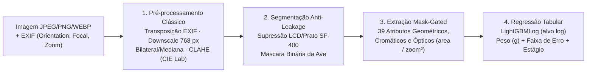

# AvianScale CV

**Estimativa não invasiva de peso vivo de frangos de corte (*Cobb Avian 48*) utilizando exclusivamente Processamento Digital de Imagens (PDI) clássico, calibração óptica EXIF e regressão tabular interpretável.**

[](pyproject.toml)
[](backend/app/api/main.py)
[](frontend/package.json)
[-16A34A)](#princ%C3%ADpios-cient%C3%ADficos-e-regras-anti-leakage)
[](#testes-e-verifica%C3%A7%C3%B5es-de-qualidade)

---

## Sumário

1. [Sobre o Projeto](#sobre-o-projeto)
2. [Princípios Científicos e Regras Anti-Leakage](#princípios-científicos-e-regras-anti-leakage)
3. [Arquitetura e Estrutura do Repositório](#arquitetura-e-estrutura-do-repositório)
4. [Pré-requisitos e Instalação](#pré-requisitos-e-instalação)
5. [Como Rodar Localmente](#como-rodar-localmente)
   - [Reproduzir o Pipeline Offline (a partir do dataset bruto)](#1-reproduzir-o-pipeline-offline-a-partir-do-dataset-bruto)
   - [Modo Pitch / Produção (1 comando — recomendado)](#2-modo-pitch--produção-1-comando--recomendado)
   - [Modo Desenvolvimento (Hot-Reload em 2 terminais)](#3-modo-desenvolvimento-hot-reload-em-2-terminais)
   - [Testes e Verificações de Qualidade](#4-testes-e-verificações-de-qualidade)
6. [Guia do Usuário — Como Usar e Interpretar a Aplicação](#guia-do-usuário--como-usar-e-interpretar-a-aplicação)
   - [Aba 1 — Estúdio Raio-X (`/#estudio`)](#aba-1--estúdio-raio-x-estudio)
   - [Aba 2 — Separação Watershed (`/#watershed`)](#aba-2--separação-watershed-watershed)
   - [Aba 3 — Auditoria & Métricas (`/#metricas`)](#aba-3--auditoria--métricas-metricas)
   - [Aba 4 — Visão Futura v2 (`/#visao-futura`)](#aba-4--visão-futura-v2-visao-futura)
7. [Glossário de Termos, Métricas e Resultados](#glossário-de-termos-métricas-e-resultados)
   - [Métricas Estatísticas e de Uniformidade](#métricas-estatísticas-e-de-uniformidade)
   - [Validação, Ablação Óptica e Testes Contrafactuais](#validação-ablação-óptica-e-testes-contrafactuais)
   - [PDI Clássico, Óptica EXIF e Descritores Morfométricos/Cromáticos](#pdi-clássico-óptica-exif-e-descritores-morfométricoscromáticos)
8. [Resultados Auditados (v1.0 MVP)](#resultados-auditados-v10-mvp)
9. [Referência Rápida da API Local](#referência-rápida-da-api-local)
10. [Limitações Conhecidas e Roadmap Futuro](#limitações-conhecidas-e-roadmap-futuro)
11. [Fonte dos Dados e Créditos](#fonte-dos-dados-e-créditos)

---

## Sobre o Projeto

Na avicultura de corte, a pesagem manual por amostragem gera estresse animal, demanda mão de obra e fornece baixa frequência de acompanhamento do ganho de peso e da uniformidade do lote.

O **AvianScale CV** demonstra um sistema de visão computacional **de baixo custo, leve (100% CPU) e totalmente auditável** para estimar o peso vivo individual (`116–2.093 g`, aproximadamente `~7–29 dias`) e simular a média/uniformidade de lote de frangos *Cobb Avian 48*, validado sobre toda a base limpa do dataset público *Broiler weights of Cobb Avian* (`1.738` imagens limpas, `160` pesos únicos, `188` sessões de captura).

A interface web local exibe em **menos de 100 ms** (meta `< 500 ms`):
- O passo a passo visual do PDI (**"visão Raio-X"** em 4 estágios);
- A calibração óptica via metadados EXIF com prova ao vivo de invariância entre lentes (**Wide vs. Ultrawide**);
- Um módulo interativo de **Watershed por Marcadores** para separação de aves encostadas em grupo;
- Um painel científico completo de **Auditoria & Métricas** com validação 5-fold sem vazamento de dados.



---

## Princípios Científicos e Regras Anti-Leakage

O projeto foi construído sob cinco garantias técnicas rígidas verificadas por testes automatizados:

1. **100% PDI Clássico e ML Tabular (Zero Deep Learning):** Não utiliza CNNs, YOLO, ViTs, SAM ou OCR. Toda segmentação usa espaços de cor CIE Lab/HSV, filtragem bilateral/mediana, CLAHE, morfologia matemática, contornos, elipses e Watershed; a regressão usa modelos tabulares clássicos (`Ridge`, `Huber`, `RandomForest`, `LightGBM`).
2. **Zero Vazamento Visual do Visor LCD da Balança:** O visor LCD, botões e prato da balança digital SF-400 são suprimidos de forma invariante à rotação antes da segmentação. Todos os atributos são calculados **estritamente dentro da máscara da ave (`bird_mask == 255`)**, comprovado por teste automatizado de perturbação externa com diferença exata **`0,0`**.
3. **Zero Vazamento de Split (Validação por Sessão):** Fotos em rajada (~9 imagens da mesma ave) nunca são divididas entre treino e validação. Toda avaliação usa **`StratifiedGroupKFold` em 5 folds agrupados por `session_id`** (intervalo `> 10 min`), garantindo **`0` sobreposição de sessões**. Presets exibidos na interface usam o modelo do fold em que aquela ave **não participou do treino** (*Out-of-Fold*).
4. **Higiene de Dados e Repositório:** O dataset bruto (`3,54 GiB`), Parquets processados, binários `.joblib`, `frontend/dist/` e `node_modules/` ficam fora do Git. Os artefatos versionados em `models/*.json` usam apenas identificadores opacos (`image_id`) sem nomes de arquivo originais ou caminhos locais.
5. **Escopo Honesto de MVP v1:** A v1 opera sobre imagens estáticas únicas. Recursos de galpão com vídeo contínuo (*tracking* multi-frame, câmera fixa de teto, alertas sanitários) aparecem exclusivamente como roadmap conceitual estático na Aba 4.

---

## Arquitetura e Estrutura do Repositório

### Stack Tecnológica

| Camada | Tecnologias |
|---|---|
| **PDI Clássico & Ingestão** | Python `3.12` (`uv`), `opencv-python-headless`, `scikit-image`, `scipy`, `pillow`, `numpy`, `pandas`, `pyarrow` |
| **Modelagem Tabular** | `scikit-learn`, `lightgbm`, `joblib` |
| **API Backend Local** | `fastapi`, `uvicorn[standard]`, `pydantic v2`, `python-multipart` |
| **Frontend Web Studio** | React `19`, TypeScript `7`, Vite `8`, Tailwind CSS `v4`, Recharts `3`, Lucide React |
| **Qualidade & Testes** | `pytest`, `httpx`, `ruff`, `vitest`, `@biomejs/biome`, `tsc` (dual-project) |

### Árvore de Diretórios

```text
broiler-weight-cv/
├── backend/
│   ├── app/
│   │   ├── config.py              # Constantes de caminhos e limites da API
│   │   ├── ingestion/             # Ingestor forense (Audit §9), decodificação e split 5-fold
│   │   ├── pdi/                   # Motor PDI clássico (EXIF, CLAHE, anti-LCD, 49 features, Raio-X, Watershed)
│   │   ├── modeling/              # Wrappers, ablação óptica 4-vias, contrafactual, bundle e estágio etário
│   │   └── api/                   # FastAPI modular (routers, schemas Pydantic v2, services, guardrails ASVS L1)
│   ├── scripts/
│   │   ├── build_manifest.py      # CLI Fase 1: gera manifest_clean.parquet e manifest_quarantine.parquet
│   │   ├── extract_features.py    # CLI Fase 2: extrai features_clean.parquet em lote (--workers 4)
│   │   └── train_and_evaluate.py  # CLI Fase 3: treina, audita ablação e publica weight_regressor.joblib
│   └── tests/                     # 272 testes automatizados (ingestão, PDI, invariância, ML, API, segurança)
├── frontend/
│   ├── src/
│   │   ├── components/            # layout/, studio/ (Aba 1), watershed/ (Aba 2), metrics/ (Aba 3), vision/ (Aba 4)
│   │   ├── hooks/                 # Hooks React abort-safe e controle de estado
│   │   ├── lib/                   # Cliente HTTP tipado, formatação pt-BR, cálculo de lote/CV%, scatter
│   │   └── types/                 # Contratos TypeScript espelhando Pydantic v2
│   └── dist/                      # Build de produção (gerado localmente, fora do Git)
├── models/
│   ├── dataset_audit_summary.json # Resumo forense versionado (Fase 1)
│   ├── pdi_calibration_audit.json # Auditoria empírica dual-lens versionada (Fase 2)
│   ├── evaluation_report.json     # Métricas 5-fold OOF e ablação óptica versionadas (Fase 3)
│   ├── presets_catalog.json       # Catálogo de presets com image_id opaco (Fase 3)
│   └── weight_regressor.joblib    # Bundle produção + 5 folds (gerado localmente, fora do Git)
├── data/
│   ├── raw/                       # Dataset público bruto (baixado localmente, fora do Git)
│   └── processed/                 # Parquets gerados localmente (fora do Git)
├── pyproject.toml                 # Dependências Python 3.12 travadas
└── uv.lock                        # Lockfile determinístico (apenas wheels binários)
```

---

## Pré-requisitos e Instalação

- **Linux / macOS / WSL2** (testado em Linux x86_64)
- **[`uv`](https://docs.astral.sh/uv/)** para gerenciar o ambiente Python `3.12` automaticamente
- **Node.js `>= 22.12`** (testado em `v24.21.0`) e `npm`
- **Dataset público *Broiler weights of Cobb Avian*** (Mendeley Data, DOI [`10.17632/zrs8kk9dvr.1`](https://doi.org/10.17632/zrs8kk9dvr.1)) extraído em:
  ```text
  data/raw/Broiler weights of Cobb Avian/
  ```

### Instalação das Dependências

```bash
# 1. Clonar o repositório
git clone https://github.com/PhilZeraNTC/broiler-weight-cv.git
cd broiler-weight-cv

# 2. Instalar ambiente Python 3.12 exato a partir do lockfile
uv sync --frozen

# 3. Instalar dependências do frontend
cd frontend
npm ci
cd ..
```

---

## Como Rodar Localmente

### 1. Reproduzir o Pipeline Offline (a partir do dataset bruto)

> **Nota:** Se você já possui `data/processed/*.parquet`, `models/weight_regressor.joblib` e `frontend/dist/` gerados na sua máquina, **pode pular direto para o passo 2**.

Em uma instalação nova após colocar o dataset em `data/raw/Broiler weights of Cobb Avian/`:

```bash
# Etapa 1 — Curadoria forense e split 5-fold anti-leakage (~3 s)
uv run python -m backend.scripts.build_manifest

# Etapa 2 — Extração clássica das 49 features em lote sobre as 1.738 imagens (~47 s)
uv run python -m backend.scripts.extract_features --workers 4

# Etapa 3 — Treinamento, ablação óptica 4-vias e geração de models/weight_regressor.joblib (~60 s)
uv run python -m backend.scripts.train_and_evaluate

# Etapa 4 — Compilar o bundle de produção do frontend (~1 s)
cd frontend && npm run build && cd ..
```

---

### 2. Modo Pitch / Produção (1 comando — recomendado)

O FastAPI serve tanto a API `/api/*` quanto a interface React compilada (`frontend/dist/`) em uma única origem local, sem CORS e com latência típica de `56–80 ms`:

```bash
uv run uvicorn backend.app.api.main:app --host 127.0.0.1 --port 8000 --workers 1
```

Abra no navegador:
- **Aplicação Web:** `http://127.0.0.1:8000`
- **Documentação interativa da API (Swagger):** `http://127.0.0.1:8000/docs`

> Para encerrar o servidor, pressione `Ctrl + C` no terminal.

---

### 3. Modo Desenvolvimento (Hot-Reload em 2 terminais)

Use este modo se for editar o código Python ou React:

- **Terminal 1 — Backend FastAPI (`:8000`):**
  ```bash
  uv run uvicorn backend.app.api.main:app --reload --host 127.0.0.1 --port 8000
  ```
- **Terminal 2 — Frontend Vite (`:5173`, com proxy automático `/api` → `:8000`):**
  ```bash
  cd frontend && npm run dev
  ```
  Acesse `http://localhost:5173`.

---

### 4. Testes e Verificações de Qualidade

```bash
# Backend: 272 testes (ingestão, PDI, invariância 0,0-diff, ML, API, segurança) + linter Ruff
uv run pytest
uv run ruff check backend/

# Frontend: checagem de tipos (TS 7 dual-project), linter Biome v2, 26 testes Vitest e build
cd frontend
npm run typecheck
npm run lint
npm test
npm run build
```

---

## Guia do Usuário — Como Usar e Interpretar a Aplicação

A aplicação possui **4 abas** acessíveis no topo (com suporte a links diretos por hash ou rota, como `/#estudio`, `/#watershed`, `/#metricas` e `/#visao-futura`).

### Aba 1 — Estúdio Raio-X (`/#estudio`)

Ambiente principal para estimar o peso de uma ave individual e inspecionar cada etapa do PDI clássico.

1. **Galeria de Presets Curados (avaliação Out-of-Fold honesta):**
   - Ao abrir a página, o preset **`Frango em Crescimento (~550 g)`** carrega automaticamente.
   - Os 6 presets cobrem toda a curva de crescimento e usam o modelo do fold em que aquela ave **nunca foi vista no treino**:

   | Preset | Cenário / Lente | Peso Real | Estimado (OOF) | Propósito na Demonstração |
   |---|---|---|---|---|
   | **Pintinho Jovem (~180 g)** | Balança/Cama · Ultrawide | `180 g` | `249,7 g` | Fase inicial com alta penugem amarela |
   | **Frango em Crescimento (~550 g)** | Balde Dorsal · Wide | `576 g` | `424,0 g` | Fase intermediária em vista dorsal |
   | **Frango Pesado (~1.600 g)** | Balança/Cama · Ultrawide | `1.555 g` | `998,3 g` | Cauda rara `> 1.000 g` (expõe subestimação honesta) |
   | **Caso Difícil — Balde Branco** | Balde Dorsal · Ultrawide | `1.986 g` | `968,2 g` | Segmentação branco-sobre-branco sem fallback |
   | **Par Dual-Lens — Wide (4,25 mm)** | Balança/Cama · Wide | `541 g` | `383,2 g` | Mesma ave/sessão (`Fold 0`) em lente Wide |
   | **Par Dual-Lens — Ultrawide (1,65 mm)** | Balança/Cama · Ultrawide | `541 g` | `384,2 g` | Mesma ave/sessão (`Fold 0`) — diferença de apenas **`0,94 g`**! |

   - Clique em **"Comparar Par Dual-Lens"** para executar as duas fotos do mesmo frango (`541 g`) em paralelo e provar ao vivo que a calibração óptica neutraliza a troca de lente.

2. **Upload de Foto Própria + Calibração Óptica Manual:**
   - Arraste ou selecione qualquer imagem **JPG, PNG ou WEBP** (até `15 MB`).
   - O sistema lê automaticamente a **Distância Focal** e o **Zoom** do cabeçalho EXIF.
   - Se a foto vier sem EXIF (ex.: imagem do WhatsApp, print ou PNG), um **aviso âmbar** aparece e aplica valores padrão seguros (`4,25 mm` / `1,0×`), permitindo ajustar manualmente **Distância Focal (`0,5–200 mm`)** e **Zoom (`0,1–20×`)** e clicar em **"Reprocessar com Óptica Ajustada"** para ver o efeito direto no peso estimado.

3. **Visão Raio-X em 4 Etapas (grade 2×2 + Lightbox):**
   - **Etapa 1 — Original (EXIF Corrigido):** foto rotacionada corretamente via tag EXIF `Orientation`.
   - **Etapa 2 — Pré-processamento (Bilateral + CLAHE Lab):** ruído suavizado preservando bordas e contraste local realçado na luminância `L`.
   - **Etapa 3 — Máscara Binária (Sem LCD):** silhueta branca isolada da ave (`bird_mask == 255`) com o visor LCD/prato da SF-400 excluído.
   - **Etapa 4 — Overlay Geométrico:** contorno final, elipse ajustada e eixos maior/menor desenhados sobre a ave.
   - Clique em qualquer quadro para abrir em tela cheia (**Lightbox**).

4. **Card de Resultado, Estágio Etário e Lote Simulado:**
   - Exibe o **Peso Estimado** em gramas e quilogramas (`g` / `kg`), a **Faixa de Erro Esperada** (`±MAE` e `p68` daquela faixa de peso), o tempo de processamento em `ms` e o **Estágio *Cobb Avian 48***:
     - `< 350 g`: *Inicial / Pintinho* (`~7–13 dias`)
     - `350–700 g`: *Crescimento Inicial* (`~14–19 dias`)
     - `700–1.200 g`: *Crescimento Intermediário* (`~20–24 dias`)
     - `> 1.200 g`: *Terminação / Pré-Abate* (`~25–29 dias`)
     - Valores fora de `116–2.093 g` acendem o aviso de **extrapolação fora da faixa treinada**.
   - Em **Telemetria**, você inspeciona indicadores-chave (área normalizada, solidez, excentricidade, razão de penugem amarela vs. plumagem branca) e pode expandir a tabela completa dos **39 atributos *mask-gated***.
   - No **Simulador de Lote**, clique em **"Adicionar ao Lote"** após cada análise para acompanhar em tempo real a **quantidade de aves**, o **peso médio**, o **desvio-padrão** e a **uniformidade (`CV%`)** do grupo simulado.

---

### Aba 2 — Separação Watershed (`/#watershed`)

Demonstra como o PDI clássico consegue separar aves **encostadas umas nas outras** em cenas multi-aves — sem redes neurais.

1. **Presets Multi-Aves & Upload:**
   - Inclui os 4 grupos reais quarentenados do dataset (`417 g` / 2 aves com comedouro vermelho, `757 g` / 2 aves, `823 g` / 4 aves e `1.520 g` / 2 aves) além de upload customizado.
2. **Banner Permanente `group_sum_only`:**
   - Indica explicitamente que, na base pública, essas pastas contêm **apenas o peso total somado do grupo**. Logo, os pesos individuais por ave retornados nesta aba são **ilustrativos** (calculados passando as 39 features de cada bacia pelo modelo de ave única), acompanhados da soma estimada e da média de referência do grupo.
3. **Ajuste Interativo de Parâmetros do Watershed (Sliders):**

   | Parâmetro | Faixa Aceita | Padrão | O que faz na imagem |
   |---|---|---|---|
   | **`h_rel`** *(Proeminência de Pico)* | `0,05 – 0,80` | `0,20` | Altura relativa mínima para um pico na Transformada de Distância virar uma "semente" de ave. **Menor** = detecta mais aves (pode dividir uma ave em duas); **Maior** = funde picos próximos (pode juntar duas aves encostadas). |
   | **`min_distance_rel`** *(Distância Mínima)* | `0,20 – 2,50` | `0,85` | Separação mínima entre centros de duas sementes vizinhas. Aumente se uma mesma ave estiver sendo partida ao meio. |
   | **`min_area_ratio`** *(Área Mínima da Bacia)* | `0,01 – 0,45` | `0,10` | Fração mínima da área de uma região para ser aceita como ave válida; descarta fragmentos de borda, cama de palha ou patas soltas. |

4. **4 Estágios + Tabela por Instância:**
   - Mostra Original, Máscara Pré-processada (sem comedouro vermelho/LCD), Mapa de Distância Euclidiana (EDT) com marcadores de pico e Bacias Coloridas do Watershed.
   - A tabela associa cada **cor da bacia** à sua área em pixels, área normalizada, solidez e peso individual ilustrativo.

---

### Aba 3 — Auditoria & Métricas (`/#metricas`)

Painel de transparência científica alimentado diretamente por `models/evaluation_report.json` e `models/dataset_audit_summary.json`:

- **KPIs Executivos 5-Fold:** `MAE`, `RMSE`, `BalMAPE`, `R²` por imagem e `R²` agregado por sessão (com contexto honesto frente ao benchmark da literatura `R² > 0,90` em câmera fixa vertical de teto).
- **Gráfico Real vs. Estimado (`ScatterChart`):** alterne entre **`1.738` imagens individuais** e **`188` sessões agregadas** e filtre por **faixa de peso**, **lente** e **cenário**. Quanto mais próximos os pontos estiverem da linha tracejada **`y = x`**, maior a precisão.
- **Gráfico de Ablação Óptica (`C1`–`C4`):** compara o erro sem calibração (`C1`), com calibração física estrita (`C2` — vencedor), com metadados brutos (`C3` — desqualificado) e com dupla contagem focal×zoom (`C4` — desqualificado).
- **Top-12 Atributos Mais Importantes:** mostra quais descritores clássicos mais pesam nas decisões do `LightGBMLog`.
- **Erros Estratificados & Matriz de 16 Modelos:** detalha o desempenho por faixa de peso (`<500 g`, `500–1000 g`, `>1000 g`), por lente (`Wide` vs. `Ultrawide`) e por cenário (`Balde Dorsal` vs. `Balança/Cama`), além da tabela completa das 4 famílias × 4 condições.
- **Funil Forense (`1.753 → 1.738`):** documenta todas as anomalias descobertas em disco e reconcilia transparentemente a alegação publicada no Mendeley (*"1.772 imagens / 45 dias"*) contra a realidade auditada em disco (`1.753` arquivos reais em `9` datas, cobrindo `~7–29 dias` / `116–2.093 g`, com hiato de amostragem entre `801 g` e `1.216 g`).

---

### Aba 4 — Visão Futura v2 (`/#visao-futura`)

Painel estático de arquitetura comparando o **MVP v1 (câmera handheld/balde com calibração EXIF)** com a evolução comercial **v2 (câmera fixa no teto do aviário a altura constante $Z_{\text{const}}$)**, incluindo os requisitos planejados `BARN-01`, `BARN-02` e `BARN-03` (sem simular telemetria falsa ou vídeo em tempo real).

---

## Glossário de Termos, Métricas e Resultados

### Métricas Estatísticas e de Uniformidade

| Termo | Significado Simples | Como Interpretar no AvianScale CV |
|---|---|---|
| **MAE** *(Mean Absolute Error)* | Erro médio absoluto em gramas (`g`). | Quanto, em média, a estimativa erra para mais ou para menos. Menor é melhor (`158,11 g` global; `93,15 g` em `<500 g`). |
| **RMSE** *(Root Mean Squared Error)* | Raiz do erro quadrático médio (`g`). | Penaliza erros grandes com mais força que o MAE. Útil para enxergar desvios na cauda pesada `> 1.000 g` (`264,02 g`). |
| **MAPE** *(Mean Absolute Percentage Error)* | Erro percentual médio absoluto (`%`). | Erro relativo ao peso real da ave. Muito sensível em pintinhos pequenos (ex.: errar `50 g` em `150 g` = `33%`). |
| **BalMAPE** *(Balanced Band MAPE)* | Média aritmética do MAPE nas 3 faixas (`<500 g`, `500–1000 g`, `>1000 g`). | Evita que os `70,4%` de pintinhos leves escondam o erro nas aves pesadas (`35,11%`). Critério principal de seleção do modelo vencedor. |
| **MBE** *(Mean Bias Error)* | Viés médio com sinal (`Estimado − Real`, em `g`). | Positivo = modelo tende a **superestimar**; Negativo = tende a **subestimar** (ex.: `-578,5 g` em `>1.000 g` pela escassez de amostras pesadas). |
| **p68 / p90** | Percentis 68% e 90% do erro absoluto (`g`). | `p68` funciona como uma faixa de erro típica (~1 desvio-padrão empírico): 68% das estimativas erram no máximo esse valor. |
| **R² (por imagem vs. por sessão)** | Coeficiente de determinação (quanto da variância real do peso o modelo explica; `1,0` = perfeito). | **`0,5582`** em fotos individuais handheld e **`0,6905`** ao tirar a média das fotos de uma mesma sessão (reduz ruído de postura e *motion blur*). |
| **CV%** *(Coeficiente de Variação)* | `(Desvio-Padrão / Média) × 100` no Simulador de Lote. | Mede a **uniformidade do lote** na avicultura: `< 10%` excelente uniformidade; `10–15%` boa; `> 15%` lote heterogêneo. |

### Validação, Ablação Óptica e Testes Contrafactuais

| Termo | Significado Simples | Por que é Importante |
|---|---|---|
| **OOF** *(Out-of-Fold)* | Predição feita por um modelo que **não viu aquela ave/sessão** durante o treino. | Garante honestidade científica: os erros exibidos nos presets e no painel são erros reais de generalização, nunca de memorização. |
| **`session_id` & `StratifiedGroupKFold`** | Agrupamento de fotos tiradas em sequência da mesma ave (intervalo `≤ 10 min`) mantendo todas juntas no mesmo fold, com equilíbrio entre faixas de peso. | Impede *split leakage* — o erro clássico de colocar 8 fotos da mesma ave no treino e a 9ª foto na validação. |
| **Ablação Óptica (`C1`–`C4`)** | Experimento controlado comparando o mesmo algoritmo com 4 conjuntos diferentes de atributos ópticos: | Prova matematicamente o ganho da calibração física:<br>• **`C1`** (`uncalibrated_pdi`): áreas brutas em pixels, sem EXIF.<br>• **`C2`** (`physics_normalized_strict`): **vencedor** — apenas `area_px / zoom²` e derivados, sem expor qual lente foi usada.<br>• **`C3`** (`physics_plus_exif_meta`): adiciona `focal_length_mm` e `zoom_multiple` crus (árvores usam como atalho de classe de lente).<br>• **`C4`** (`naive_double_count_fxz`): divide por `(focal × zoom)²`, causando dupla contagem da lente. |
| **Teste Contrafactual (`focal_only` e `physical_lens_swap`)** | Simula trocar a lente Wide ↔ Ultrawide mantendo o mesmo frango físico, e mede quanto a predição muda (`%`). | Detecta *confounding* (atalho espúrio): como aves `> 1.000 g` foram fotografadas mais vezes em Ultrawide (`56–78%`), modelos em `C3` e `C4` "trapaceiam" prevendo peso alto só por detectar a lente (`10,8%` e `17,6%` de desvio), sendo **desqualificados**. **`C2` tem exatamente `0,0%` de desvio**. |
| **`PDIConfig Hash`** | Impressão digital SHA-256 (`43a3cfaa3208019e`) dos parâmetros exatos do motor PDI. | Garante que o processamento online na API é 100% idêntico ao que gerou a base de treino (`0,0000 g` de deriva). |

### PDI Clássico, Óptica EXIF e Descritores Morfométricos/Cromáticos

| Termo | Significado Simples | Papel na Estimativa |
|---|---|---|
| **EXIF (`Orientation`, `FocalLength`, Xiaomi `39321`)** | Metadados gravados pela câmera dentro do arquivo JPEG. | Corrige a rotação de `81,86%` das fotos, identifica Wide (`4,25 mm`) vs. Ultrawide (`1,65 mm`) e lê o fator real de zoom digital (`zoomMultiple`) gravado na tag proprietária Xiaomi `39321` (`0x9999`). |
| **CLAHE (CIE Lab)** | *Contrast Limited Adaptive Histogram Equalization* aplicado apenas no canal de luminância `L`. | Realça contornos locais (crucial para aves brancas dentro do balde plástico branco) sem distorcer as cores (`a*`, `b*`). |
| **Mask-Gated (`bird_mask == 255`)** | Extração restrita aos pixels classificados como pertencentes à ave. | Garante matematicamente que nenhum pixel do visor LCD, cama de palha ou balde vaze para os atributos do modelo. |
| **`area_optical_norm` (`area_px / zoom²`)** | Área projetada da ave dividida pelo quadrado do fator de zoom óptico/digital. | Corrige a variação de até `6,6×` na área em pixels entre lentes; validada em `127` sessões dual-lens com razão Wide/Ultrawide = **`0,9638`** no balde. |
| **Eixo Maior / Menor da Elipse** | Comprimento e largura da elipse ajustada à silhueta da ave (normalizados por `zoom`). | Capturam o porte corporal da ave (`minor_axis_optical_norm` é o 2º atributo mais importante do modelo). |
| **Solidez (*Solidity*)** | `Área da ave / Área do fecho convexo` (`0` a `1`). | Mede quão compacta é a silhueta; valores baixos indicam asas/patas abertas ou ruído de contorno. |
| **Circularidade & Excentricidade** | Quão próximo de um círculo (`1,0`) ou alongado (`→ 1,0` na excentricidade) é o corpo. | Ajuda a diferenciar postura agachada/dorsal de vista lateral oblíqua. |
| **Momentos de Hu (`log_hu_1..3`)** | Invariantes matemáticos de forma (escala, rotação e translação). | Descrevem a geometria global da silhueta independentemente da orientação da ave na imagem. |
| **Penugem Amarela (`yellow_down_ratio`) vs. Plumagem Branca (`white_plumage_ratio`)** | Fração de pixels internos com tonalidade amarela típica de pintinhos jovens vs. penas brancas adultas. | Sinal biológico forte de idade/peso, totalmente invariante à distância da câmera! |
| **Canais CIE Lab (`lab_l`, `lab_a`, `lab_b`) & Textura (`feather_grad_mean`, `feather_laplacian_var`)** | Estatísticas de cor/luminância e gradiente/nitidez das penas dentro da máscara. | Capturam transição de penugem macia para penas estruturadas e tonalidade de pele/crista (`lab_a_p10` e `lab_a_mean` estão no Top 3 do modelo). |
| **EDT & Watershed por Marcadores** | Transformada de Distância Euclidiana (mede distância de cada pixel interno até a borda) + inundação topográfica a partir dos picos de distância. | Separa aves encostadas encontrando automaticamente o "vale" exato entre dois corpos vizinhos. |

---

## Resultados Auditados (v1.0 MVP)

Resultados oficiais em validação cruzada **5-fold `StratifiedGroupKFold` por `session_id`** (`1.738` imagens limpas / `188` sessões, zero vazamento), persistidos em [models/evaluation_report.json](models/evaluation_report.json):

### Modelo Vencedor: `LightGBMLog` sob `C2_physics_normalized_strict` (`39` atributos)

| Escopo de Avaliação | Amostras | MAE (g) | RMSE (g) | MAPE (%) | BalMAPE (%) | R² |
|---|---:|---:|---:|---:|---:|---:|
| **Global (por imagem)** | `1.738` | **`158,11 g`** | **`264,02 g`** | `37,09%` | **`35,11%`** | **`0,5582`** |
| **Agregado por sessão** | `188` | **`145,30 g`** | **`234,49 g`** | `31,29%` | — | **`0,6905`** |
| Faixa `< 500 g` (`70,4%`) | `1.223` | `93,15 g` | — | `39,63%` | — | — |
| Faixa `500–1.000 g` (`19,2%`) | `333` | `160,76 g` | — | `26,67%` | — | — |
| Faixa `> 1.000 g` (`10,5%`) | `182` | `589,77 g` | — | `39,04%` | — | — |

### Estudo de Ablação Óptica (`LightGBMLog`)

| Condição | MAE (g) | RMSE (g) | BalMAPE (%) | R² (Sessão) | Desvio Contrafactual (`physical_lens_swap`) | Decisão de Auditoria |
|---|---:|---:|---:|---:|---:|---|
| `C1_uncalibrated_pdi` (sem EXIF) | `164,27 g` | `275,19 g` | `36,19%` | `0,6578` | `11,71%` | Baseline (inferior) |
| **`C2_physics_normalized_strict`** | **`158,11 g`** | **`264,02 g`** | **`35,11%`** | **`0,6905`** | **`0,00%`** | **Vencedor Aprovado** |
| `C3_physics_plus_exif_meta` | `156,56 g` | `263,17 g` | `34,79%` | `0,6956` | `10,82%` | Desqualificado (*lens shortcut*) |
| `C4_naive_double_count_fxz` | `155,84 g` | `260,14 g` | `34,48%` | `0,7024` | `17,56%` | Desqualificado (dupla contagem) |

### Desempenho Operacional e Watershed

- **Latência ponta a ponta `/api/predict`:** `56,1 – 79,7 ms` em CPU local (meta `< 500 ms`).
- **Latência `/api/watershed-demo`:** `138,3 – 152,1 ms` em CPU local.
- **Watershed multi-aves (`13` imagens reais de `417`, `757`, `823`, `1520`):** **`9/13` contagens exatas**, **`12/13` dentro de `±1` ave** (`MAE = 0,38` aves).
- **Robustez de segmentação:** apenas `4 / 1.738` (`0,23%`) de fallback primário (`0 / 377` no balde branco dorsal, incluindo `0 / 59` aves `> 1.000 g` branco-sobre-branco) e `0` falsos positivos de LCD no balde.

---

## Referência Rápida da API Local

| Método | Rota | Descrição |
|---|---|---|
| `GET` | `/api/health` | Status da API, `pdi_config_hash`, modelo vencedor e verificação `classical_pdi_only: true` |
| `GET` | `/api/presets` | Lista os `6` presets OOF de ave única e os `4` presets Watershed (IDs opacos) |
| `GET` | `/api/presets/{preset_id}/thumbnail` | Miniatura JPEG (`320 px`, transposta via EXIF) servida do cache em RAM |
| `POST` | `/api/predict` | Executa o pipeline PDI clássico + regressão (`preset_id` ou `file` + overrides ópticos opcionais) |
| `POST` | `/api/watershed-demo` | Executa Watershed interativo (`preset_id` ou `file` + `h_rel`, `min_distance_rel`, `min_area_ratio`) |
| `GET` | `/api/metrics` | Retorna relatório completo 5-fold, `1.738` pontos OOF, ablação `C1`–`C4` e funil forense |

---

## Limitações Conhecidas e Roadmap Futuro

### Limitações Honestas da Base Pública Atual (v1.0)
- **Captura manual (*handheld*) sem distância fixa:** a altura da câmera varia foto a foto, o que impõe um teto físico de precisão (`R² = 0,69` por sessão vs. `R² > 0,90` com câmera fixa vertical no teto).
- **Desbalanceamento e hiato de cobertura:** `70,4%` das amostras têm `< 500 g`, há uma lacuna acentuada entre `801 g` e `1.216 g` (apenas 1 sessão) e a base encerra em `2.093 g` (`~29 dias`, sem fase final comercial `30–45 dias`).
- **Obturador lento:** exposições de `1/20–1/50 s` introduzem *motion blur* em parte das capturas.

### Próximos Passos Planejados (`v1.1` e `v2.0`)
- **`v1.1` Hardening:** calibração geométrica clássica `mm/pixel` pela borda do balde (Hough), filtro de nitidez por variância do Laplaciano para rejeitar frames borrados, validação *Leave-One-Date-Out* e exportação CSV/PDF do lote simulado.
- **`v2.0` Aviário Comercial:** câmera fixa vertical no teto a altura conhecida ($Z_{\text{const}}$ → área real em $\text{cm}^2$), coleta de dados até o peso de abate (`2,1–3,2 kg`, `30–45 dias`) e empacotamento *edge* CPU-only (Raspberry Pi / câmera industrial).

---

## Fonte dos Dados e Créditos

- **Dataset Público:** *Broiler weights of Cobb Avian* (Mendeley Data — DOI: [`10.17632/zrs8kk9dvr.1`](https://doi.org/10.17632/zrs8kk9dvr.1)), linhagem *Cobb Avian 48*, capturado com Xiaomi Redmi 10 e balança SF-400.
- **Histórico de Entregas e Auditoria Técnica:** consulte [.planning/MILESTONES.md](.planning/MILESTONES.md) e [.planning/RETROSPECTIVE.md](.planning/RETROSPECTIVE.md).
